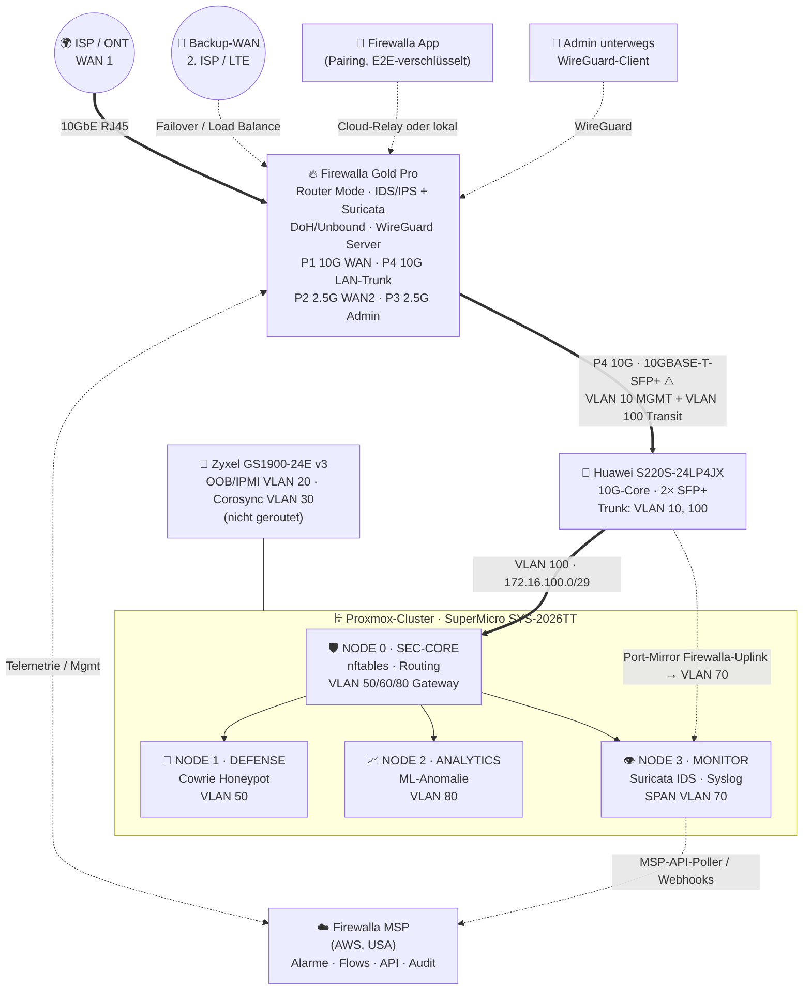
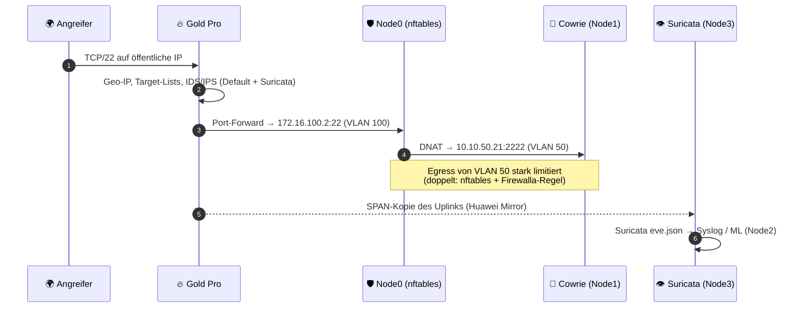
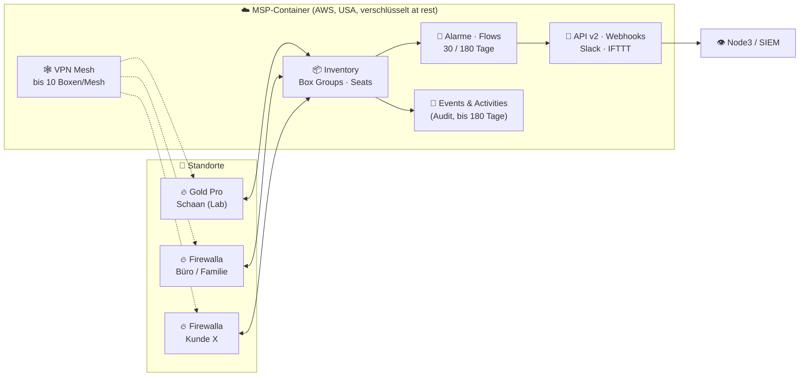

<div align="center">

# 🔥 Firewalla Gold Pro + MSP

### Warum es eine brillante, kosteneffiziente Enterprise-Firewall ist – und wo die ehrlichen Grenzen liegen

*Ein didaktisches Handbuch und Referenz-Repository: Firewalla Gold Pro als Perimeter-Firewall vor einem 4-Node-Proxmox-Security-Lab, zentral verwaltet mit Firewalla MSP.*


</div>

---

> [!IMPORTANT]
> **Ehrlichkeits-Versprechen:** Dieses Repository ist **keine Werbung** und hat keine Verbindung zu Firewalla Inc. Alle Zahlen sind entweder **Herstellerangaben mit Link**, **Listenpreise von Händlern mit Link** oder **ausdrücklich als Schätzung/Annahme ⚠️ gekennzeichnet**. Recherchestand: **13. Oktober 2026**. Preise ändern sich – vor dem Kauf immer selbst prüfen. Die Schattenseiten stehen im [🔍 Reality Check](docs/reality-check.md).

> 🤝 **Companion-Repository:** Dieses Repo ergänzt **[node300-net/sovereign-datacenter](https://github.com/node300-net/sovereign-datacenter)** – dort ist die Firewalla Gold Pro der **Perimeter** eines 4-Node-Proxmox-Clusters (SuperMicro 2026TT). Hier geht es um die Firewall selbst: Was sie kann, was sie kostet, wie MSP funktioniert und wie sie sich in den Cluster einfügt.

## 📚 Inhaltsverzeichnis

- [🗺️ Repository-Struktur](#️-repository-struktur)
- [⚡ TL;DR – Warum Gold Pro?](#-tldr--warum-gold-pro)
- [🧾 Hardware auf einen Blick (verifiziert)](#-hardware-auf-einen-blick-verifiziert)
- [🌐 Topologie: Gold Pro vor dem Proxmox-Cluster](#-topologie-gold-pro-vor-dem-proxmox-cluster)
- [🛡️ Rollenverteilung: Wer filtert was?](#️-rollenverteilung-wer-filtert-was)
- [🚀 Quickstart](#-quickstart)
- [☁️ MSP in 60 Sekunden](#️-msp-in-60-sekunden)
- [💰 TCO-Kurzfassung](#-tco-kurzfassung)
- [🔍 Reality Check (Kurzfassung)](#-reality-check-kurzfassung)
- [📖 Quellen](#-quellen)
- [📜 Lizenz](#-lizenz)

---

## 🗺️ Repository-Struktur

| Pfad | Inhalt |
|---|---|
| [`docs/features.md`](docs/features.md) | Feature-Deep-Dive: IDS/IPS (Default + Suricata), Regeln, VLANs, VPN Server/Client, Site-to-Site, DoH/Unbound, Ad Block, Smart Queue, Multi-WAN, PBR |
| [`docs/msp.md`](docs/msp.md) | Firewalla MSP: Pläne & Preise, Seats, Multi-Site, Box Groups, Audit (Events/Activities), Alarme, Rollen, API & Webhooks, VPN Mesh, Crystal |
| [`docs/tco-comparison.md`](docs/tco-comparison.md) | Ehrlicher Vergleich vs. pfSense/OPNsense, UniFi UDM Pro/Pro Max, FortiGate, Sophos XGS, Palo Alto – TCO über 3 & 5 Jahre |
| [`docs/reality-check.md`](docs/reality-check.md) | Grenzen: geschlossenes Ökosystem, Cloud-Abhängigkeit, kein TLS-Inspection, kein HA, Durchsatz mit IDS/CAKE/PPPoE, RJ45-only u. v. m. |
| [`configs/`](configs/README.md) | VLAN-Plan (MD + YAML), Regelwerk-Konzept, WireGuard-Site-to-Site-Beispiele, Node-3-Integration (Suricata/Syslog/MSP-API) |
| `LICENSE` | MIT (Code/Configs) + CC BY-SA 4.0 (Dokumentation) |
| `CONTRIBUTING.md` | Kurzleitfaden für Beiträge |

---

## ⚡ TL;DR – Warum Gold Pro?

| 💡 Argument | Was dahintersteckt | Beleg |
|---|---|---|
| 💸 **Kein Box-Abo** | Alle Standard-Features sind im Kaufpreis enthalten – IDS/IPS, VPN-Server, Ad Block, Regeln, Updates | Firewalla-FAQ: *„There is no monthly fee. All standard features are included with your Firewalla device.“* [¹](https://firewalla.com/products/firewalla-gold-pro) |
| 🚄 **10G mit IDS/IPS** | Herstellerangabe 10 Gbps Packet Processing *mit* IDS/IPS, 3 Länder-Blocks, 1000er-Target-List | [Produktwahl-Guide](https://help.firewalla.com/hc/en-us/articles/360010465893) · Lab-Test 9,41 Gbps [²](https://help.firewalla.com/hc/en-us/articles/27792411968787-Firewalla-Gold-Pro) |
| 🧠 **Zwei IDS-Engines** | Default-Engine + **Suricata** (nur Gold Pro) + optional MSP-Engine | [Protect-Artikel](https://help.firewalla.com/hc/en-us/articles/360049856394) |
| 🔐 **VPN ohne Lizenz** | WireGuard (2 Gbps), OpenVPN (500 Mbps), AmneziaWG; bis 20 Site-to-Site-Verbindungen | [Produktseite](https://firewalla.com/products/firewalla-gold-pro) |
| 🧩 **Segmentierung** | Unbegrenzte VLANs, Device-/Group-/Network-Regeln, Quarantäne neuer Geräte | [Produktseite](https://firewalla.com/products/firewalla-gold-pro) |
| ☁️ **MSP optional** | Multi-Site, Audit-Log, Webhooks, API – ab **0 $** (Lite) bzw. ab **~49 $/Jahr** (Professional) | [MSP-Intro](https://help.firewalla.com/hc/en-us/articles/4409866753427) · [Seats](https://help.firewalla.com/hc/en-us/articles/25037436951699) |
| 🧮 **TCO** | 5 Jahre Gold Pro + MSP Professional ≈ **1'200 $** vs. FortiGate 90G UTP 5 J. **13'200 $** (Liste) | [TCO-Doku](docs/tco-comparison.md) |

> ⚖️ **Fair bleiben:** Gold Pro ist **kein** vollwertiges NGFW im Sinne von Palo Alto/Fortinet/Sophos – es gibt **keine TLS-Entschlüsselung**, **kein Stateful-HA**, **kein BGP/OSPF**. Für ein Security-Lab und KMU-Perimeter ist das Preis-Leistungs-Verhältnis trotzdem herausragend. Details: [Reality Check](docs/reality-check.md).

---

## 🧾 Hardware auf einen Blick (verifiziert)

| Merkmal | Gold Pro (Herstellerangabe) | Quelle | Status |
|---|---|---|---|
| **CPU** | Quad-Core 64-bit **Intel 12th Gen** | [Produktseite](https://firewalla.com/products/firewalla-gold-pro) | ✅ |
| **CPU-Modell** | Intel **N97** (laut Presse-Review, nicht auf der Firewalla-Seite genannt) | PC Pro, Jan. 2025 (via [pocketmags](https://pocketmags.com/au/pc-pro-magazine/january-2025/articles/firewalla-gold-pro)) | ⚠️ unverifiziert |
| **RAM** | **8 GB** | Produktseite | ✅ |
| **Ports** | **2× 10 GbE NBASE-T** + **2× 2.5 GbE NBASE-T**, **alle RJ45** – **kein SFP/SFP+** | [Gold-Pro-FAQ](https://help.firewalla.com/hc/en-us/articles/27792411968787-Firewalla-Gold-Pro) | ✅ |
| **Port-Speeds** | 10G-Ports: 10/5/2.5/1 G (100 M „most likely“); 2.5G-Ports: 2.5/1 G/100 M | Gold-Pro-FAQ | ✅ |
| **Packet Processing** | **10 Gbps** (mit IDS/IPS, 3× Region-Block, Target-List) | [Produktwahl-Guide](https://help.firewalla.com/hc/en-us/articles/360010465893) | ✅ Herstellerangabe |
| **WireGuard** | **2 Gbps** | Produktseite | ✅ Herstellerangabe |
| **OpenVPN** | **500 Mbps** | Produktseite | ✅ Herstellerangabe |
| **Site-to-Site** | **20× Verbindungen** | Produktseite | ✅ |
| **PPPoE** | Download **9'000 Mbps** / Upload **7'000 Mbps** | Produktseite | ✅ Herstellerangabe |
| **VLANs / Geo-IP** | Unlimited / Unlimited | Produktseite | ✅ |
| **Leistungsaufnahme** | **~17 W bis 33 W** (Netzteil 12 V / 3 A) | Produktseite | ✅ |
| **Gehäuse** | Metall, 21.7 × 16.5 × 4.3 cm, 1'090 g, Console-Port, Rack-Kit optional | Produktseite · FAQ | ✅ |
| **Wi-Fi** | Nein (AP7 oder eigener AP) | Produktseite | ✅ |
| **Garantie** | 1 Jahr Herstellergarantie | Produktseite | ✅ |
| **Preis** | **939 $** (Aktion) / **999 $** regulär, Stand 13.10.2026; zzgl. Versand, Zoll, MWST | Produktseite | ✅ (volatil) |
| **Zielgruppe** | *„small business/enterprise, commercial, schools … not intended for residential use“* | Produktseite | ✅ |

---

## 🌐 Topologie: Gold Pro vor dem Proxmox-Cluster



> 💡 **Wichtig:** Die Gold Pro hat **nur RJ45-Ports**, der Huawei-Core aber **nur SFP+** für 10G. Für einen 10G-Link brauchst du ein **10GBASE-T-SFP+-Modul** – Kompatibilität mit dem S220S und Wärme-/Leistungsbudget des Ports sind **⚠️ nicht verifiziert** (siehe [RC-3](docs/reality-check.md#rc-3)). Fallback: 1G-RJ45-Port des Huawei oder 2.5G-SFP-Port mit passendem Modul.

### 🔁 Paketfluss: Internet → Honeypot (Cowrie)



---

## 🛡️ Rollenverteilung: Wer filtert was?

**Defense in Depth** heisst: Jede Schicht macht das, was sie am besten kann – und keine verlässt sich blind auf die andere.

| Schicht | Gerät | Aufgabe | Warum dort? |
|---|---|---|---|
| 🌍 **Perimeter** | 🔥 **Firewalla Gold Pro** | NAT, Ingress-Firewall, Geo-IP, IDS/IPS, DoH/Unbound, Ad/Threat-Blocking, WireGuard-Remote-Access, Multi-WAN, Smart Queue | Einfach, 10G-fähig, gute Visibility per App/MSP, keine Lizenzkosten |
| 🛡️ **Inner Firewall** | Node 0 **SEC-CORE** (nftables) | Ost-West-Segmentierung VLAN 50/60/80, DNAT zum Honeypot, Egress-Policy des Labs | Volle Kontrolle, Code-as-Config, auditierbar (siehe Companion-Repo) |
| 🍯 **Deception** | Node 1 **Cowrie** | Angreifer binden, Credentials/TTPs sammeln | Isoliert in DMZ-VLAN 50 |
| 📈 **Analytics** | Node 2 **ML** | Baseline/Anomalien aus Flows, Suricata-Events, MSP-Alarmen | GPU, Zeitreihen |
| 👁️ **Detection** | Node 3 **Suricata + Syslog** | Unabhängige zweite IDS-Meinung via SPAN, zentrales Logging | Firewalla-unabhängig, volle Rule-Kontrolle |

> 🧠 **Didaktischer Kernpunkt:** Die Firewalla ist **der freundliche Türsteher**, Node 0 ist **die Zutrittskontrolle im Gebäude**, Node 3 ist **die Videoüberwachung**. Fällt einer aus oder wird umgangen, sehen die anderen weiterhin etwas.

---

## 🚀 Quickstart

> [!CAUTION]
> Alle Konfigurationen sind **Beispiele mit Platzhaltern** (`<<PLACEHOLDER>>`, `10.10.x.x`, `203.0.113.0/24`). Firewalla wird primär über **App/MSP** konfiguriert – die YAML-Dateien in `configs/` sind **Planungsdokumente**, keine importierbaren Firewalla-Configs (es gibt kein offizielles Config-as-Code-Import-Format).

```text
0) Vorbereitung
   - Companion-Repo lesen: https://github.com/node300-net/sovereign-datacenter (VLAN-Plan, nftables)
   - CAT6a-Kabel für 10G (Firewalla-Empfehlung) bereitlegen
   - Smartphone mit Firewalla-App (Pflicht für Ersteinrichtung)

1) Box in Betrieb nehmen
   - Port 1 (10G) → ISP/ONT  |  Port 4 (10G) → Huawei-Core (10GBASE-T-SFP+, ⚠️ prüfen)
   - App: Box pairen → Router Mode wählen (Gold Pro unterstützt KEINEN Simple Mode)

2) Netzwerke anlegen (App → Network Manager)  → configs/network/vlan-plan.md
   - VLAN 10 MGMT 10.10.10.0/24 (Firewalla = Gateway)
   - VLAN 100 TRANSIT 172.16.100.0/29 (Firewalla .1, Node0 .2)
   - Statische Routen: 10.10.50/24, 10.10.60/24, 10.10.80/24 via 172.16.100.2
   - NAT Source Networks um die gerouteten Netze ergänzen (MSP → Network Manager → NAT Settings)

3) Schutz aktivieren (App → Protect / Controls)
   - Active Protect: Default Engine + Suricata (Gold Pro)
   - Region Blocking, Advanced Threat Filtering, Bypass Prevention
   - DoH oder Unbound, Ad Block für MGMT-Clients

4) Regeln nach configs/rules/ruleset-concept.yaml umsetzen
   - VLAN 60 LAB: Internet BLOCK (zusätzlich zu nftables auf Node0)
   - VLAN 50 DMZ: Egress stark limitiert; Port-Forward 22/tcp → 172.16.100.2

5) Remote-Zugang
   - WireGuard-Server aktivieren, Profile pro Admin, IPv6 auf WG-Netzen beachten
   - Optional zweiter Standort: configs/wireguard/site-to-site.md

6) Smart Queue (CAKE/FQ_Codel) erst NACH Speedtest aktivieren – kostet Durchsatz!

7) MSP (optional): firewalla.net → Plan wählen → Box ins Inventory
   - Node3: configs/integration/msp-alarms-to-syslog.py als Timer/Service
```

```bash
# Node 3: MSP-Alarme → lokales rsyslog → Suricata-/SIEM-Pipeline
export MSP_DOMAIN="<<yourmsp>>.firewalla.net"
export MSP_TOKEN="<<PERSONAL_ACCESS_TOKEN>>"     # niemals committen!
python3 configs/integration/msp-alarms-to-syslog.py --once --dry-run
```

---

## ☁️ MSP in 60 Sekunden



| Plan | Preis (Stand 10/2026) | Kern |
|---|---|---|
| **Lite** | **kostenlos** | 1 Box, 24 h Flows |
| **Professional** | **~4.99 $/Monat bzw. 49 $/Jahr** ⚠️ | 30-Tage-Flows-Seat inkl., bis 100 Seats, 1 VPN-Mesh, API/Webhooks |
| **Business** | **29.99 $/Monat bzw. 299 $/Jahr** | 180-Tage-Flows-Seat inkl., bis 10 Admins, 3 Meshes, Temporary Access, HA-Backend |

⚠️ Professional wurde mit MSP 2.11 um ~1 $ angehoben (vorher 3.99 $/39 $) – Details & Quellen in **[docs/msp.md](docs/msp.md)**.

---

## 💰 TCO-Kurzfassung

> Listen-/Shoppreise in **USD**, ohne MWST, Versand, Zoll, Strom. Quellen & Annahmen: **[docs/tco-comparison.md](docs/tco-comparison.md)**.

| Lösung | 10G-fähig? | IPS-Durchsatz (Hersteller) | 3 Jahre | 5 Jahre |
|---|---|---|---|---|
| 🔥 **Firewalla Gold Pro** (ohne MSP) | ✅ 2× 10G RJ45 | 10 Gbps „packet processing“ inkl. IDS/IPS | **939–999 $** | **939–999 $** |
| 🔥 **Gold Pro + MSP Professional** | ✅ | ″ | **~1'086–1'146 $** | **~1'184–1'244 $** |
| 🔥 **Gold Pro + MSP Business** | ✅ | ″ | **~1'836–1'896 $** | **~2'434–2'494 $** |
| 🟦 UniFi UDM Pro Max (+ CyberSecure) | ✅ 2× SFP+ | 5 Gbps | 599 $ (896 $) | 599 $ (1'094 $) |
| 🟧 OPNsense/pfSense auf eigener HW | ✅ (je nach NIC) | ⚠️ hardwareabhängig | ⚠️ 300–800 $ HW + 0–~400 $ | ⚠️ + 0–~800 $ |
| 🔴 FortiGate 90G UTP-Bundle | ✅ 2× 10G shared | 4.5 Gbps IPS / 2.2 Gbps Threat | **9'375 $** | **13'200 $** |
| 🔵 Sophos XGS 2100 Xstream | ⚠️ nur mit Flexi-Modul | 6 Gbps IPS / 1.25 Gbps Threat | **12'006 $** | **18'101 $** |
| 🟠 Palo Alto PA-440 (+ Core Security) | ❌ 1 GbE | – | ⚠️ ~4'300–5'300 $ + Support | ⚠️ ~6'400–7'900 $ + Support |

> ⚠️ **Äpfel vs. Birnen:** FortiGate, Sophos und Palo Alto liefern **TLS-Inspection, App-Control mit L7-Signaturen, Sandboxing, HA, SLA-Support**. Firewalla nicht. Die Tabelle zeigt, **was du für dein Bedrohungsmodell wirklich bezahlen musst**, nicht dass alle dasselbe können.

---

## 🔍 Reality Check (Kurzfassung)

Volle Version mit Begründungen: **[docs/reality-check.md](docs/reality-check.md)**.

| # | Thema | Kurzfassung |
|---|---|---|
| RC-1 | 🔒 **Geschlossenes Ökosystem** | Proprietäres Management (App/MSP), kein offizielles Config-Export/Import-Format, Feature-Roadmap liegt beim Hersteller. SSH-Zugang existiert, Änderungen sind aber nicht supportet/updatefest. |
| RC-2 | ☁️ **Cloud-Abhängigkeit** | Ersteinrichtung braucht Smartphone-App; Remote-Zugriff/Benachrichtigungen über Firewalla-Cloud; **MSP läuft in AWS-Containern in den USA** (Datenschutz FL/CH/EU prüfen!). Filtering läuft lokal weiter. |
| RC-3 | 🔌 **Nur RJ45** | Kein SFP+. 10GBASE-T-SFP+-Module im Huawei/X710 → Kompatibilität, Wärme, Leistung ⚠️ prüfen. CAT6a nötig. |
| RC-4 | 🐢 **Durchsatz ist kontextabhängig** | 9.41 Gbps (DHCP-WAN, IDS an) im Herstellerlab – aber **PPPoE + CAKE nur ~2.44 Gbps Download**, Suricata *„extremely hardware-intensive“*. |
| RC-5 | 🕵️ **Kein TLS-Inspection** | Firewalla sieht Metadaten (IP, Domain, SNI/Zertifikat, Volumen), **nie** verschlüsselte Inhalte. Kein NGFW-L7-Payload-Filter. |
| RC-6 | ♻️ **Kein HA, kein BGP/OSPF** | Kein Stateful-Failover zweier Boxen; Multi-WAN max. **2 WANs**. Box = Single Point of Failure. |
| RC-7 | 📤 **Logging-Export** | Kein offizieller Remote-Syslog; offiziell: MSP-API/Webhooks. rsyslog-Forwarding nur per Community-Skript (unsupportet). |
| RC-8 | 🧭 **Routed Subnets hinter Node 0** | Firewalla ist geräte-/MAC-zentriert. Hinter einem zweiten Router sieht sie IPs, aber ⚠️ eingeschränkte Geräteerkennung. |
| RC-9 | 🧾 **Support & Garantie** | 1 Jahr Garantie, Support per E-Mail/Community; kein bekanntes SLA-Angebot wie FortiCare ⚠️. |

---

## 📖 Quellen

| Thema | Quelle |
|---|---|
| Gold Pro Produktseite (Specs, Preis, FAQ „no monthly fee“) | <https://firewalla.com/products/firewalla-gold-pro> |
| Gold Pro FAQ & Herstellerlab-Benchmarks | <https://help.firewalla.com/hc/en-us/articles/27792411968787-Firewalla-Gold-Pro> |
| Produktvergleich & Messmethodik | <https://help.firewalla.com/hc/en-us/articles/360010465893> |
| Protect / Suricata | <https://help.firewalla.com/hc/en-us/articles/360049856394> · <https://help.firewalla.com/hc/en-us/articles/43467157290643> |
| Paket-Tiefe / keine TLS-Inspection | <https://help.firewalla.com/hc/en-us/articles/360008659013> |
| Site-to-Site VPN | <https://help.firewalla.com/hc/en-us/articles/5515850433683-Firewalla-Site-to-Site-VPN> |
| Multi-WAN | <https://help.firewalla.com/hc/en-us/articles/360051575473-Firewalla-Feature-Guide-Multi-WAN> |
| MSP Intro / Features / Rollen | <https://help.firewalla.com/hc/en-us/articles/4409866753427> |
| MSP Seats & Preise | <https://help.firewalla.com/hc/en-us/articles/25037436951699> · <https://firewalla.net/plans> |
| MSP 2.11 Release | <https://help.firewalla.com/hc/en-us/articles/52488806297235> |
| MSP API | <https://docs.firewalla.net/> · <https://github.com/firewalla/msp-api-examples> |
| VPN Mesh | <https://help.firewalla.com/hc/en-us/articles/15766848784275-Firewalla-MSP-VPN-Mesh> |
| Firewalla Crystal (eigene HW) | <https://help.firewalla.com/hc/en-us/articles/55229535959059> |
| Wettbewerber | siehe [docs/tco-comparison.md](docs/tco-comparison.md#-quellen) |
| Companion: Cluster, VLAN-Plan, nftables | <https://github.com/node300-net/sovereign-datacenter> |

---

## 📜 Lizenz

- 🧑‍💻 **Code & Konfigurationen** (`configs/`, Skripte): **MIT** – siehe [LICENSE](LICENSE)
- 📝 **Dokumentation** (`README.md`, `docs/`): **CC BY-SA 4.0**
- ™️ „Firewalla“, „FortiGate“, „Sophos“, „Palo Alto Networks“, „UniFi“, „pfSense“, „OPNsense“ sind Marken der jeweiligen Inhaber. Keine Affiliation.

<div align="center">

**🔥 Buy once. Segment everything. Trust nothing you can't verify.**

</div>
