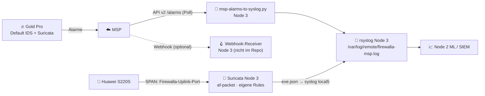

# 👁️ Integration mit Node 3 (Suricata IDS & Syslog)

> Zurück zu [configs/](../README.md) · Hintergrund: [RC-7 Logging-Export](../../docs/reality-check.md#rc-7)

## ✅ / ❌ Was ist wirklich unterstützt? (verifiziert, Stand 13.10.2026)

| Weg | Status | Quelle |
|---|---|---|
| Firewalla **Suricata-Engine auf der Box** (Gold Pro) | ✅ offiziell – aber **keine** dokumentierte Rule-/Log-Schnittstelle | [Protect](https://help.firewalla.com/hc/en-us/articles/360049856394) |
| **Remote-Syslog** aus der Box | ❌ nicht offiziell; Firewalla verweist auf MSP-Flow-API | [Community-Antwort](https://help.firewalla.com/hc/en-us/community/posts/28656048693011-Firewalla-gold-traffic-logs-syslog-to-remote-log-server) |
| rsyslog-Forwarding per SSH + `post_main.d`-Hook | 🟡 Community, unsupportet | [Gist mbierman](https://gist.github.com/mbierman/f3d184b65e0f4de6fa75a4a5d5145426) |
| **MSP-API** (Alarme, Flows) | ✅ offiziell (Professional/Business) | [docs.firewalla.net](https://docs.firewalla.net/) |
| **MSP-Webhooks** (Alarme) | ✅ offiziell | [Integrations](https://help.firewalla.com/hc/en-us/articles/4416385766803-Integrations-for-Firewalla-MSP) |
| NetFlow/IPFIX/sFlow, SNMP | ❌ ⚠️ nicht in offizieller Doku gefunden | – |
| **Eigenes Suricata auf Node 3 via SPAN** | ✅ unabhängig von Firewalla | Switch-Feature + [Suricata-Doku](https://docs.suricata.io/) |

## 🏗️ Empfohlene Architektur



**Warum doppelt?** Die Firewalla-Engines sind eine **Black Box** (keine eigenen Rules, keine Rohlogs). Suricata auf Node 3 gibt dir **volle Kontrolle** (ET Open, eigene Rules für Honeypot-TTPs) und **lokale Retention** – unabhängig von Cloud und Abo. Die MSP-Alarme sind die **zweite Meinung** und liefern Firewalla-spezifischen Kontext (Geräte, Regeln, „Matched By“).

## 🔁 SPAN – was spiegeln?

| Mirror-Quelle | Sieht | Nachteil |
|---|---|---|
| Huawei-Port zur **Firewalla (P4-Trunk)** | Alles zwischen Perimeter und Cluster (Nord-Süd), **nach** NAT, mit echten internen IPs | Kein Ost-West |
| Ports zu Node 0 (VLAN 50/60) | Ost-West im Lab | Mehr Last |

> ⚠️ Oversubscription: Ein 10G-Uplink, gespiegelt auf einen 1G-Port von Node 3 (82574L), **verliert Pakete** unter Last. Besser: Mirror-Ziel = X710-Port von Node 3 oder nur Teilverkehr spiegeln. Huawei-Syntax: [`huawei-span.example`](huawei-span.example) (⚠️ nicht am S220S verifiziert).

## ▶️ Inbetriebnahme Node 3

```bash
# 1) rsyslog
install -m 0644 rsyslog-node3.conf /etc/rsyslog.d/30-firewalla.conf
mkdir -p /var/log/remote && systemctl restart rsyslog

# 2) Suricata (Debian 13): Snippet in /etc/suricata/suricata.yaml einarbeiten
apt install suricata && suricata-update && suricata -T -c /etc/suricata/suricata.yaml

# 3) MSP-Poller (Token als systemd-Credential/Env-Datei, nie im Repo!)
install -m 0755 msp-alarms-to-syslog.py /usr/local/bin/
install -m 0600 /dev/null /etc/firewalla-msp.env   # MSP_DOMAIN=…  MSP_TOKEN=…
install -m 0644 msp-alarms-to-syslog.{service,timer} /etc/systemd/system/
systemctl daemon-reload && systemctl enable --now msp-alarms-to-syslog.timer
journalctl -u msp-alarms-to-syslog -n 50
```
