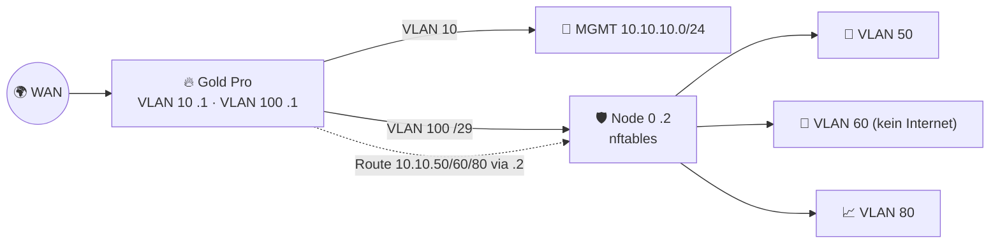

# 🗺️ VLAN-Plan & Port-Map – Gold Pro im Sovereign-Datacenter

> Basiert auf dem VLAN-Plan von [sovereign-datacenter → docs/architecture.md](https://github.com/node300-net/sovereign-datacenter/blob/main/docs/architecture.md). Maschinenlesbar: [`vlan-plan.yaml`](vlan-plan.yaml).

## 🔌 Port-Map Gold Pro

| Port | Speed | Rolle | Gegenstelle | Hinweis |
|---|---|---|---|---|
| **P1** | 10G NBASE-T | **WAN 1** (DHCP/PPPoE/Static) | ISP-ONT/Modem | CAT6a |
| **P2** | 2.5G NBASE-T | **WAN 2** (Failover) | 2. ISP / LTE-Router | Multi-WAN max. 2 |
| **P3** | 2.5G NBASE-T | Admin-Notfallport (VLAN 10 untagged) | Admin-Laptop | Optional; „Break-Glass“ |
| **P4** | 10G NBASE-T | **LAN-Trunk** (802.1Q: VLAN 10, 100) | Huawei S220S SFP+ via 10GBASE-T-Modul ⚠️ | Siehe [RC-3](../../docs/reality-check.md#rc-3) |

> ⚠️ Die physische Port-Nummerierung (welcher Port 10G ist) laut Firewalla-Doku: 10G-Ports sind laut Suchergebnissen **Port 1 und 4** – am Gerät beschriftungsbasiert prüfen.

## 🏷️ VLANs – wer ist Gateway?

| VLAN | Name | Subnetz | Gateway | Firewalla-Rolle |
|---|---|---|---|---|
| **10** | MGMT | `10.10.10.0/24` | **Firewalla `.1`** | Direkt angeschlossen; DHCP, DoH/Unbound, Ad Block, Quarantäne |
| **20** | OOB | `10.10.20.0/24` | – | ❌ **nicht** an Firewalla (nur Zyxel, nur Jumphost) |
| **30** | COROSYNC | `10.10.30.0/24` | – | ❌ nicht geroutet |
| **40** | STORAGE | `10.10.40.0/24` | – | ❌ nicht geroutet |
| **50** | DMZ-HONEY | `10.10.50.0/24` | Node 0 | 🧭 statische Route via `172.16.100.2`; Egress-Regeln |
| **60** | LAB-REDTEAM | `10.10.60.0/24` | Node 0 | 🧭 statische Route; **Internet BLOCK** (Defense in Depth) |
| **70** | SPAN | – | – | ❌ nur Mirror → Node 3 |
| **80** | ANALYTICS | `10.10.80.0/24` | Node 0 | 🧭 statische Route; Allow: Updates, MSP-API (Node 3 Poller ⚠️ läuft in VLAN 10 oder 80) |
| **100** | WAN-TRANSIT | `172.16.100.0/29` | **Firewalla `.1`** ↔ Node 0 `.2` | Übergabe Perimeter → SEC-CORE |

## 🧭 Statische Routen auf der Firewalla

| Ziel | Next Hop | Interface |
|---|---|---|
| `10.10.50.0/24` | `172.16.100.2` | VLAN 100 |
| `10.10.60.0/24` | `172.16.100.2` | VLAN 100 |
| `10.10.80.0/24` | `172.16.100.2` | VLAN 100 |

## 🔄 NAT

- Firewalla NATtet nach WAN. **Source Networks** um `10.10.50.0/24`, `10.10.80.0/24` ergänzen (MSP → Network Manager → NAT Settings) – `10.10.60.0/24` bewusst **nicht** (kein Internet).
- Node 0 **routet ohne NAT** → Firewalla sieht echte Quell-IPs.
- Port-Forward: `WAN:22/tcp → 172.16.100.2:22` (Node 0 DNAT → Cowrie `10.10.50.21:2222`).

