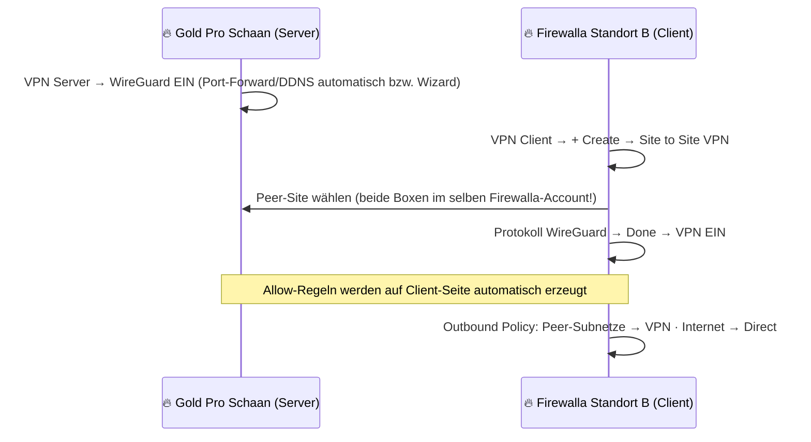
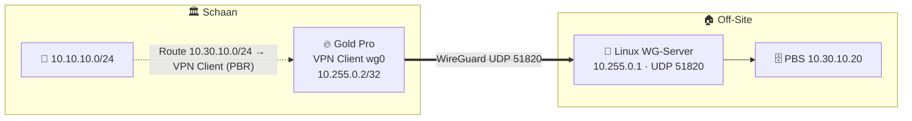

# 🔐 WireGuard Site-to-Site – zwei Wege

> Quellen: [Firewalla Site to Site VPN](https://help.firewalla.com/hc/en-us/articles/5515850433683-Firewalla-Site-to-Site-VPN) · [WireGuard VPN Server Configuration](https://help.firewalla.com/hc/en-us/articles/1500004087521-WireGuard-VPN-Server-Configuration) · [VPN Client](https://help.firewalla.com/hc/en-us/articles/360023379953-Firewalla-VPN-Client) · [VPN Mesh](https://help.firewalla.com/hc/en-us/articles/15766848784275-Firewalla-MSP-VPN-Mesh)

| Weg | Gegenstelle | Konfiguration | Offiziell? |
|---|---|---|---|
| 🅰️ **Firewalla ↔ Firewalla** | zweite Firewalla-Box | Klicks in der App, **keine Config-Datei** | ✅ |
| 🅱️ **Firewalla (Client) → Linux/OPNsense (WG-Server)** | beliebiger WireGuard-Server | `.conf` in Firewalla „VPN Client → WireGuard“ importieren + Routes | ✅ VPN Client mit 3rd-Party-WireGuard; Site-to-Site-Semantik (Routen) ⚠️ selbst bauen |
| 🅲 **MSP VPN Mesh** | bis 10 Firewalla-Boxen | MSP-UI | ✅ (Early Access, Professional/Business) |

---

## 🅰️ Firewalla ↔ Firewalla



**Checkliste:**

- [ ] Subnetze **überschneiden sich nicht** (Schaan `10.10.0.0/16`, Standort B z. B. `10.20.0.0/16`).
- [ ] IPv6 auf den betroffenen LANs aus oder bewusst akzeptieren: WireGuard-S2S routet **kein IPv6** (Stand 09/2026).
- [ ] Internet-Policy **Direct** (sonst läuft aller Traffic über Schaan).
- [ ] Nur gewünschte Netze erlauben: Block-Regeln/Target-List auf der Server-Seite (Szenarien 1–3 im Artikel).
- [ ] Nach Netzwerkänderung: Verbindung **neu anlegen**.
- [ ] Mehrere Client-Standorte untereinander: zusätzliche **Routes** auf jedem Client.

---

## 🅱️ Firewalla als WireGuard-Client zu Linux/OPNsense

Beispiel: Ein **Off-Site-Backup-Standort** (z. B. PBS bei Familie, siehe Companion-Repo 3-2-1-Regel) mit Linux-Router.



1. Auf Linux: [`remote-site-linux-server.conf.example`](remote-site-linux-server.conf.example) anpassen, `wg-quick up wg0`.
2. In der Firewalla-App: **VPN Client → + → WireGuard → Import** [`firewalla-client-import.conf.example`](firewalla-client-import.conf.example).
3. **Apply To:** *nicht* ganzen Netzen zuweisen (sonst Default-Route ins VPN), sondern **Routes** anlegen: Ziel `10.30.10.0/24` → Interface = dieser VPN-Client.
4. Rückweg: Auf Linux `AllowedIPs` enthält `10.10.10.0/24`; Firewalla muss ⚠️ NAT auf dem Tunnel machen oder nicht – **testen** (Firewalla-Client-Verbindungen sind typischerweise genattet ⚠️ unverifiziert). Bei NAT sieht die Gegenstelle nur `10.255.0.2`.
5. Keepalive aktiv lassen (dynamische IPs).

> ⚠️ Echte bidirektionale Site-to-Site-Semantik (Server-Seite erreicht beliebige Hosts in Schaan) ist mit einem **3rd-Party-Peer nicht offiziell dokumentiert**. Für Box↔Box immer Weg 🅰️ oder 🅲 nutzen.

## 🔑 Schlüssel erzeugen

```bash
umask 077
wg genkey | tee site-b.key | wg pubkey > site-b.pub
wg genkey | tee firewalla-client.key | wg pubkey > firewalla-client.pub
wg genpsk > psk
# *.key und psk NIEMALS committen (siehe .gitignore)
```
