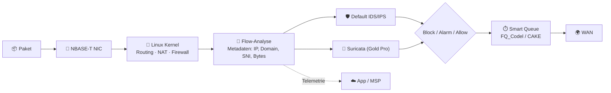
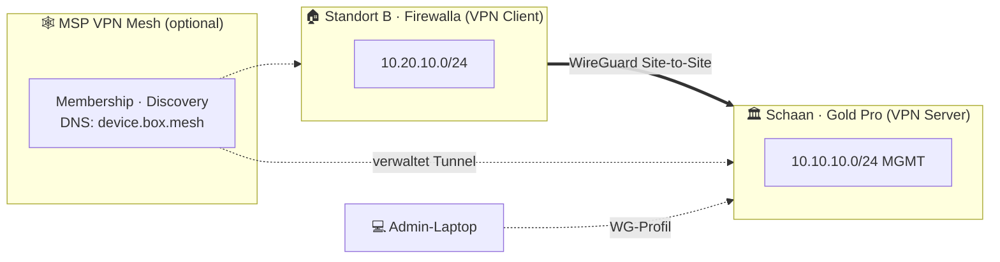

# 🧰 Feature-Deep-Dive – Was die Gold Pro wirklich kann

> Zurück zur [README](../README.md) · Weiter: [☁️ MSP](msp.md) · [💰 TCO](tco-comparison.md) · [🔍 Reality Check](reality-check.md)

Recherchestand **13.10.2026**. Legende: ✅ offiziell dokumentiert · ⚠️ unverifiziert/Einschränkung · ❌ nicht vorhanden.

---

## 📑 Inhalt

1. [Architektur: Software-Router auf x86](#-1-architektur-software-router-auf-x86)
2. [IDS/IPS – Active Protect (Multi-Engine)](#️-2-idsips--active-protect-multi-engine)
3. [Regel-Engine & Zero Trust](#-3-regel-engine--zero-trust)
4. [Netzwerk: VLANs, Routing, Multi-WAN, LAG](#-4-netzwerk-vlans-routing-multi-wan-lag)
5. [VPN: Server, Client, Site-to-Site, Mesh](#-5-vpn-server-client-site-to-site-mesh)
6. [DNS: DoH, Unbound, Ad Block, NTP Intercept](#-6-dns-doh-unbound-ad-block-ntp-intercept)
7. [Smart Queue & Policy-Based Routing](#-7-smart-queue--policy-based-routing)
8. [Monitoring, Scan, AI-Assistent](#-8-monitoring-scan-ai-assistent)
9. [Feature-Matrix kompakt](#-9-feature-matrix-kompakt)

---

## 🧬 1. Architektur: Software-Router auf x86

Die Gold Pro ist laut Hersteller ein **„software-based router“** – kein ASIC-Firewall-Appliance wie FortiGate (NP/CP-Chips) oder Sophos XGS (Xstream Flow Processor). Alles läuft auf der **x86-CPU (Intel 12th Gen, 4 Kerne)** mit 8 GB RAM. Das hat Konsequenzen:

| Eigenschaft | Bedeutung für dich |
|---|---|
| 🧠 **Software Packet Processing** | Flexibel, schnell neue Features; Durchsatz hängt aber **stark** von aktivierten Funktionen ab (IDS, CAKE, PPPoE) |
| 🐧 **Linux-Basis + SSH** | Firewalla bietet SSH-Zugang ([Artikel](https://help.firewalla.com/hc/en-us/articles/115004397274-Does-Firewalla-have-a-SSH-)). Eigene Änderungen sind **nicht supportet** und können durch Updates überschrieben werden. |
| 📱 **App-first** | Konfiguration über Firewalla-App (iOS/Android, **Pflicht**), Web via **MSP Lite** (kostenlos) oder MSP-Pläne |
| 🔁 **Router Mode** | Für Gold Pro der vorgesehene Modus; **Simple Mode** (ARP-Spoofing) wird **nicht** unterstützt, DHCP-Mode ebenfalls nicht offiziell ([FAQ](https://help.firewalla.com/hc/en-us/articles/27792411968787-Firewalla-Gold-Pro)) |
| 🌉 **Bridge Mode** | Laut Produktseite möglich: hinter bestehendem Router „transparent“ einsetzen |

---

## 🛡️ 2. IDS/IPS – Active Protect (Multi-Engine)

Quelle: [A Secure and Better Network with Firewalla (Part 3): Protect](https://help.firewalla.com/hc/en-us/articles/360049856394) · [App Release 1.66](https://help.firewalla.com/hc/en-us/articles/43467157290643)

| Engine | Typ | Verfügbarkeit | Bemerkung |
|---|---|---|---|
| 🛡️ **Default Engine** | Firewalla-eigen, verhaltens- & reputationsbasiert | ✅ alle Boxen | Für die meisten Nutzer laut Hersteller *„perfectly sufficient“* |
| 🦫 **Suricata Engine** | Signaturbasiert, Open Source | ✅ **nur Gold Pro** (App 1.66+, Box 1.981+) | *„extremely hardware-intensive“* – bei Performance-Problemen deaktivieren |
| ☁️ **MSP Engine** | Tiefere Verhaltensanalyse in der Cloud, Alarm Optimizer | ✅ mit MSP **30-/180-Tage-Seat** | Reduziert False Positives durch Archivierung |
| 🎯 **Device Active Protect (DAP)** | Lernt Verbindungsmuster pro IoT-Gerät, sperrt Abweichungen | ✅ | Phasen: Learning → Optimizing → Active |

> 💬 Herstellerzitat: *„Currently, the Firewalla Gold Pro is the only model equipped with a larger CPU and 2x the memory, allowing it to efficiently handle both engines without throttling throughput as much.“*

**Was IDS/IPS hier bedeutet – und was nicht:**

- ✅ Erkennung von Angriffen auf Protokollebene (z. B. SSH-Brute-Force, Heartbleed-artige Muster), bösartige Ziele, Scans, Datenabfluss-Anomalien ([Paket-Tiefe](https://help.firewalla.com/hc/en-us/articles/360008659013)).
- ❌ **Keine** Inspektion verschlüsselter Payloads (TLS). Suricata sieht bei HTTPS nur Handshake-Metadaten (SNI, Zertifikat, JA3-artige Merkmale ⚠️ – welche Suricata-Keywords aktiv sind, ist nicht dokumentiert).
- ⚠️ **Kein** offizieller Zugriff auf das Suricata-Ruleset oder eigene Rules über die App. Für eigene Rules → **Suricata auf Node 3** (siehe [configs/integration](../configs/integration/node3-suricata-syslog.md)).

---

## 🧱 3. Regel-Engine & Zero Trust

Quelle: [Produktseite](https://firewalla.com/products/firewalla-gold-pro) · [MSP Intro → Rules](https://help.firewalla.com/hc/en-us/articles/4409866753427)

| Baustein | Was es tut | Beispiel im Lab |
|---|---|---|
| 🚪 **Ingress Firewall** | Default-Regel: blockiert unaufgeforderten Traffic aus dem Internet (*„Please do not delete this rule“*) | Bleibt; Ausnahmen nur via Port-Forward |
| 🎯 **Block/Allow-Regeln** | Ziel: Domain, IP, Port, Region, Kategorie, App, **Target List**; Scope: Device, Group, Network, alle | `10.10.60.0/24 → Internet: BLOCK` |
| 📋 **Target Lists** | Eigene Listen; MSP: bis 100 Listen × 2000 Einträge, Import aus 3rd-Party/GitHub | Threat-Feed, Honeypot-Angreifer-IPs von Node 1 |
| 🗓️ **Schedules** | Regeln zeitgesteuert | Lab-Internet nur 08–18 Uhr |
| 🔒 **New Device Quarantine** | Neue Geräte landen automatisch in restriktiver Gruppe | MGMT-VLAN: unbekannte MAC → Quarantäne |
| 🌍 **Region Blocking** | Geo-IP, unbegrenzt | Ingress aus Hochrisiko-Regionen |
| 🧭 **Bypass Prevention** | Verhindert Umgehung (z. B. fremde DNS/DoH-Resolver) | Alle Clients zwingen, Firewalla-DNS zu nutzen |
| 🧩 **Controls** | Bündel: Advanced Threat Filtering, Region Blocking, Bypass Prevention, Content Filtering, Safe Search | Ein-Klick-Baseline |
| 🔀 **Lokale Device-to-Device-Regeln** | Mit Firewalla Switch/AP7 Mikrosegmentierung | ⚠️ Huawei/Zyxel sind keine Firewalla-Switches → nur Inter-VLAN-Kontrolle über die Box |

> 🧠 **Zero-Trust-Denkweise:** *„trusting no one by default and verifying everyone“* – praktisch heisst das bei Firewalla: Quarantäne für neue Geräte, DAP für IoT, Segmentierung per VLAN, explizite Allow-Regeln zwischen Segmenten.

Regelwerk-Konzept für den Cluster: **[configs/rules/ruleset-concept.yaml](../configs/rules/ruleset-concept.yaml)**.

---

## 🌐 4. Netzwerk: VLANs, Routing, Multi-WAN, LAG

| Feature | Status | Detail | Quelle |
|---|---|---|---|
| 🏷️ **802.1Q VLANs** | ✅ unbegrenzt | Anlegen im Network Manager; Inter-VLAN 9.3 Gbps im Herstellerlab | [Produktseite](https://firewalla.com/products/firewalla-gold-pro) · [Benchmarks](https://help.firewalla.com/hc/en-us/articles/27792411968787-Firewalla-Gold-Pro) |
| 🧭 **Statisches Routing** | ✅ | Nötig für Netze hinter Node 0 | Produktseite |
| 🔁 **Dynamisches Routing (BGP/OSPF)** | ❌ | Nicht offiziell angeboten | ⚠️ Community-Konsens, keine offizielle Aussage gefunden |
| 🌍 **WAN-Typen** | ✅ DHCP, Static, PPPoE, PPPoE over VLAN, Triple Play | | Produktseite |
| ⚖️ **Multi-WAN** | ✅ **max. 2 WANs**, Failover oder Load Balancing (L3/IP-basiert) | Ping-/DNS-Konnektivitätstests, Auto-Failback | [Multi-WAN-Guide](https://help.firewalla.com/hc/en-us/articles/360051575473-Firewalla-Feature-Guide-Multi-WAN) |
| 🔗 **Link Aggregation** | ✅ | Bündeln von Ports | Produktseite |
| 📶 **Wi-Fi-SD als Backup-WAN** | ✅ | Tethering bei Ausfall | Produktseite |
| 🔄 **NAT-Einstellungen** | ✅ Source NAT/Source Networks, NAT Passthrough, UPnP, DMZ, Port Forwarding | Wichtig, damit geroutete Lab-Netze ins Internet genattet werden | [MSP Intro → Network Manager](https://help.firewalla.com/hc/en-us/articles/4409866753427) |
| 🖧 **IPv6** | ✅ | ⚠️ Über WireGuard-/AmneziaWG-Site-to-Site wird IPv6 **nicht** geroutet (nur OpenVPN) | [Site-to-Site](https://help.firewalla.com/hc/en-us/articles/5515850433683-Firewalla-Site-to-Site-VPN) |

### 📊 Herstellerlab-Benchmarks (Engineering Sample, IDS/IPS an, 3 Region-Blocks, ~8000er Target-List)

| Test | Richtung | QoS aus | FQ_Codel | CAKE |
|---|---|---|---|---|
| **WAN DHCP/Static 10G** | Download | **9.41 Gbps** | 9.36 Gbps | 8.75 Gbps |
| | Upload | 9.41 Gbps | 9.41 Gbps | 9.41 Gbps |
| **WAN PPPoE 10G** | Download | **9 Gbps** | 3.29 Gbps | **2.44 Gbps** |
| | Upload | 7 Gbps | 3.48 Gbps | 3.46 Gbps |
| **Inter-VLAN 10G** | beide | 9.3 Gbps | – | – |

Quelle: <https://help.firewalla.com/hc/en-us/articles/27792411968787-Firewalla-Gold-Pro> (iperf3 `-P4`, Laborsetup). ⚠️ **Suricata-Status bei diesen Tests nicht angegeben**; Tests stammen von einem Engineering Sample (Artikel Nov. 2024).

> 🎓 **Lerneffekt:** Die „10 Gbps“ sind real – **aber** nur ohne PPPoE-Shaping. Wer PPPoE (z. B. viele FTTH-Anschlüsse) **und** Smart Queue nutzt, landet im Herstellerlab bei **~2.4–3.5 Gbps**. Für einen 1-Gbit- oder 2.5-Gbit-Anschluss ist das egal – für 10G-FTTH nicht.

---

## 🔐 5. VPN: Server, Client, Site-to-Site, Mesh

| Typ | Protokolle | Gold-Pro-Leistung (Hersteller) | Lizenz |
|---|---|---|---|
| 🧳 **VPN Server** (Remote Access) | **WireGuard**, OpenVPN, **AmneziaWG** | WG **2 Gbps**, OpenVPN **500 Mbps** | ✅ kostenlos, *„without charging a monthly fee“* |
| 🔌 **VPN Client** (Box → Provider) | OpenVPN, WireGuard, AnyConnect, AmneziaWG; **IPsec nur via MSP** (Gold-Serie, nur als Client zu 3rd-Party-Server) | – | ✅ |
| 🏢 **Site-to-Site** | OpenVPN, WireGuard, AmneziaWG – **nur zwischen Firewalla-Boxen** | **20× Verbindungen** | ✅ |
| 🕸️ **VPN Mesh** | Automatisch erzeugte Site-to-Site-Tunnel, Mesh-DNS | 10 Boxen/Mesh | 💳 MSP Professional (1 Mesh) / Business (3 Meshes) |

**Site-to-Site – wichtige Regeln** ([Quelle](https://help.firewalla.com/hc/en-us/articles/5515850433683-Firewalla-Site-to-Site-VPN)):

1. 🧮 Subnetze dürfen sich **nicht überschneiden**.
2. 🖥️ Eine Box ist **Server**, die andere **Client**; Allow-Regeln werden auf der Client-Seite automatisch erstellt.
3. 🔁 Zwischen demselben Server/Client nur **1 VPN gleichzeitig**; ein Client max. **5 VPNs gleichzeitig**.
4. 🌐 DDNS sorgt für Reconnect bei IP-Wechsel.
5. ⚠️ Bei Änderungen der Netzwerkeinstellungen muss die Verbindung **neu erstellt** werden.
6. 🧩 Drittanbieter-Gegenstellen: Firewalla-Site-to-Site geht **nur Box↔Box**. Für Linux/OPNsense-Gegenstellen: Firewalla als **WireGuard-Client** zu fremdem Server (oder umgekehrt fremder Client an Firewalla-WG-Server) + Routen. Beispiele: **[configs/wireguard/](../configs/wireguard/site-to-site.md)**.

---

## 🧾 6. DNS: DoH, Unbound, Ad Block, NTP Intercept

| Feature | Funktion | Hinweis | Quelle |
|---|---|---|---|
| 🔒 **DNS over HTTPS (DoH)** | Verschlüsselte Upstream-Anfragen, pro Gerät/Gruppe aktivierbar, wählt Server mit niedrigster Latenz | Überschreibt klassisches DNS des Geräts; DNS Booster muss aktiv sein | [DoH-Artikel](https://help.firewalla.com/hc/en-us/articles/360038449734-DNS-over-HTTPS-DoH) |
| 🧭 **Unbound** | Lokaler validierender, rekursiver, cachender Resolver (DNSSEC) | Alternative zu DoH: keine Abhängigkeit von Cloud-Resolvern | Produktseite |
| 📕 **Custom DNS Rules** | Lokales „Adressbuch“ (Split-DNS) | Für `pve-n0-seccore.lab` etc. | Site-to-Site-Artikel |
| 🚫 **Ad Block** | Werbung/Tracker auf DNS-Ebene, pro Gerät/Netz | Für Lab-VLANs eher **aus** (verfälscht Malware-Traffic-Analysen!) | Produktseite |
| 🕐 **NTP Intercept** | Fängt NTP ab und beantwortet lokal | Gut für IoT; im Lab Konflikt mit eigenem NTP auf Node 0 vermeiden | Produktseite |

> ⚠️ Hinweis aus dem Site-to-Site-Artikel: Mit „Force DNS over VPN“ funktionieren Ad Block, Family Mode, Safe Search und DoH auf VPN-Geräten **nicht**.

---

## ⏱️ 7. Smart Queue & Policy-Based Routing

**Smart Queue** ([Artikel](https://help.firewalla.com/hc/en-us/articles/360056976594-Firewalla-Feature-Smart-Queue)) reduziert **Bufferbloat** unter Last:

| Option | Werte |
|---|---|
| Modus | **Static** oder **Adaptive** (passt sich gemessener WAN-Geschwindigkeit an, pro WAN konfigurierbar) |
| AQM | **FQ_Codel** oder **CAKE** |
| Regeln | Priorisieren oder Rate-Limit pro Device/Group/Network/global |

**Policy & Content-Based Routing (PBR):** Traffic nach Regel oder Inhaltstyp auf **VPN-Client** oder **bestimmtes WAN** schicken; Route Preference *Static* (droppen, wenn WAN down) oder *Preferred* (Failover erlaubt) – [Multi-WAN-Guide](https://help.firewalla.com/hc/en-us/articles/360051575473-Firewalla-Feature-Guide-Multi-WAN).

> 🎓 **Faustregel:** Smart Queue nur aktivieren, wenn du **Latenzprobleme unter Last** hast – und dann zuerst **FQ_Codel** testen. CAKE ist feiner, kostet laut Herstellerlab aber am meisten Durchsatz.

---

## 📡 8. Monitoring, Scan, AI-Assistent

- 📈 **Network Performance:** Speedtests, Latenz, Paketverlust pro WAN; MSP *Network Health* bis 180 Tage.
- 🔎 **Scan:** Externe offene Ports, Schwachstellen-Scan (Scope & Zeitplan), Device Port Scan, schwache Passwörter (laut Produktseite).
- 🧠 **Firewalla AI:** Hilfe bei unbekannten Geräten, Alarmen, Troubleshooting, Suchsyntax in MSP-Flows.
- 📊 **Data Usage & Monthly Data Plan** pro WAN.

---

## ✅ 9. Feature-Matrix kompakt

| Feature | Gold Pro | Bemerkung |
|---|---|---|
| Stateful Firewall + NAT | ✅ | |
| IDS/IPS Default + Suricata | ✅ | Suricata nur Gold Pro |
| Eigene Suricata-Rules | ❌ ⚠️ | nicht dokumentiert → Node 3 |
| TLS/SSL-Inspection | ❌ | bewusst nicht ([Quelle](https://help.firewalla.com/hc/en-us/articles/360008659013)) |
| App-/Kategorie-Blocking | ✅ | Domain/SNI/IP-basiert, nicht Payload |
| VLANs | ✅ unbegrenzt | |
| Multi-WAN | ✅ max. 2 | |
| BGP/OSPF | ❌ | |
| HA (2 Boxen, State-Sync) | ❌ | |
| WireGuard Server/Client/S2S | ✅ | 2 Gbps |
| IPsec | ⚠️ nur Client via MSP | |
| DoH / Unbound | ✅ | |
| Smart Queue (FQ_Codel/CAKE) | ✅ | Durchsatz-Kosten |
| Remote-Syslog / NetFlow / SNMP | ❌ ⚠️ | nicht offiziell dokumentiert; MSP-API/Webhooks als Weg |
| API | 💳 | über MSP Professional/Business |
| Monatliche Box-Gebühr | ❌ 0 $ | ✅ offiziell |
