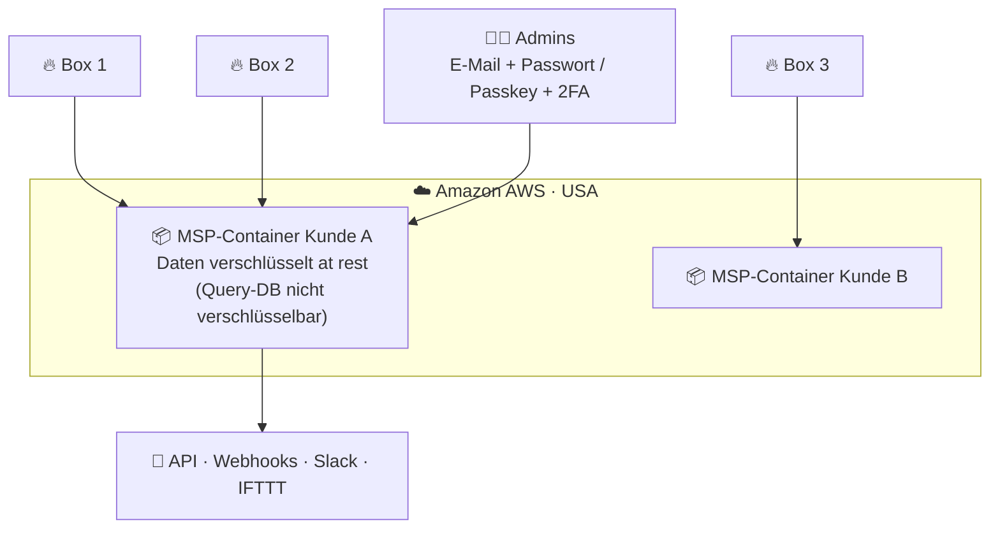
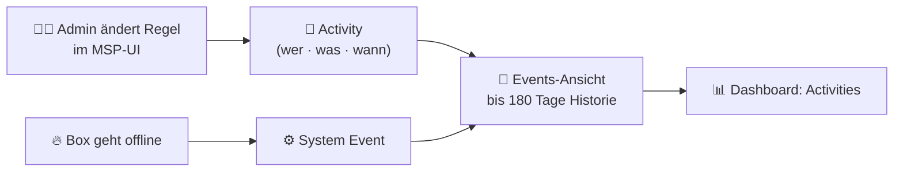

# ☁️ Firewalla MSP – Managed Security Portal

> Zurück zur [README](../README.md) · [🧰 Features](features.md) · [💰 TCO](tco-comparison.md) · [🔍 Reality Check](reality-check.md)

**Firewalla MSP** ist die cloudbasierte Web-Oberfläche, um **eine bis viele** Firewalla-Boxen zentral zu verwalten. Sie läuft **ausserhalb** der Box – das Gerät selbst bleibt abofrei ([Produkt-FAQ](https://firewalla.com/products/firewalla-gold-pro): *„For optional business features such as centralized multi-box management, we offer an additional service, Firewalla MSP … that runs outside of your Firewalla device.“*).

Primärquelle dieses Dokuments: **[Firewalla MSP Introduction](https://help.firewalla.com/hc/en-us/articles/4409866753427)** (aktualisiert 09.10.2026), ergänzt um [Managing Seats](https://help.firewalla.com/hc/en-us/articles/25037436951699), [MSP 2.11 Release](https://help.firewalla.com/hc/en-us/articles/52488806297235), [VPN Mesh](https://help.firewalla.com/hc/en-us/articles/15766848784275-Firewalla-MSP-VPN-Mesh) und [API-Doku](https://docs.firewalla.net/).

---

## 📑 Inhalt

1. [Architektur: Container in der Cloud](#️-1-architektur-container-in-der-cloud)
2. [Pläne & Preise](#-2-pläne--preise)
3. [Seats – Bezahlung pro Box](#-3-seats--bezahlung-pro-box)
4. [Multi-Site-Management](#-4-multi-site-management)
5. [Audit: Events & Activities](#-5-audit-events--activities)
6. [Alarme & Integrationen](#-6-alarme--integrationen)
7. [Rollen & Zugriff](#-7-rollen--zugriff)
8. [API](#-8-api)
9. [VPN Mesh](#️-9-vpn-mesh)
10. [Firewalla Crystal – Firewalla-Software auf eigener Hardware](#-10-firewalla-crystal--firewalla-software-auf-eigener-hardware)
11. [MSP vs. my.firewalla.com](#️-11-msp-vs-myfirewallacom)
12. [Empfehlung für den Cluster](#-12-empfehlung-für-den-cluster)

---

## 🏗️ 1. Architektur: Container in der Cloud



| Fakt | Detail | Status |
|---|---|---|
| 🧱 **Isolation** | Pro Kunde ein **isolierter Container**, Daten *„never mixed with anyone else's data“* | ✅ |
| 🌎 **Standort** | **Amazon AWS, USA** | ✅ (FAQ #9) |
| 🔐 **Verschlüsselung** | Daten at rest verschlüsselt; *„Database storage for queries cannot be encrypted.“* | ✅ |
| 🧭 **Portabilität** | Container sind an AWS gebunden – **kein Self-Hosting** (Firewalla-Kommentar: *„cloud based by design“*) | ✅ |
| 🔑 **Login** | E-Mail/Passwort, **Passkeys** (seit 2.11.1), **TOTP-2FA** für alle Pläne inkl. Lite | ✅ |
| 🌐 **Domain** | Business: Vanity-Domain (`firma.firewalla.net`); Professional: `[random].firewalla.net` | ✅ |

> ⚠️ **Datenschutz FL/CH/EU:** Flows (wer mit wem wann wie viel) sind **personenbezogene Metadaten**. Ein US-Cloud-Speicher erfordert eine Prüfung nach DSG (CH), DSGVO/EWR (FL) inkl. Auftragsverarbeitung und Drittlandtransfer. Firewalla nennt in den recherchierten Quellen **keinen** EU-Standort.

---

## 💳 2. Pläne & Preise

> [!WARNING]
> Die Live-Preisseite [firewalla.net/plans](https://firewalla.net/plans) wird per JavaScript gerendert. Die Werte unten stammen aus dem **indexierten Seiteninhalt** und dem **Help-Center** (Stand **13.10.2026**). Mit MSP 2.11 hat Firewalla angekündigt, den Professional-Preis für **Neukunden um ~1 $/Monat** zu erhöhen ([Forum-Ankündigung](https://forum.firewalla.com/t/msp-2-11-is-in-early-access-the-msp-web-interface-now-supports-more-app-features/126)). **Vor Kauf auf der Live-Seite prüfen.**

| | 🆓 **Lite** | 💼 **Professional** | 🏢 **Business** |
|---|---|---|---|
| **Preis monatlich** | **0 $** | **~4.99 $** ⚠️ (vorher 3.99 $) | **29.99 $** |
| **Preis jährlich** | **0 $** | **49 $** (≈ 4.08 $/Monat) ⚠️ (vorher 39 $) | **299 $** (≈ 25 $/Monat) |
| **Trial** | – | 3 Monate zum Preis von 1 | 3 Monate zum Preis von 1 |
| **Zielgruppe** | *„personal users“* | *„families & SOHO users“* | *„MSP and small businesses“* |
| **Inklusive Seat** | 1 (24 h Flows) | 1× **30-Day-Flows** | 1× **180-Day-Flows** |
| **Seat-Limit** | 1 | bis **100** (Aufpreis) | bis **100** (Aufpreis; mehr auf Anfrage, dedizierter Server) |
| **Flow-Speicher** | 24 h | bis 30 Tage | bis 180 Tage |
| **Alarm-Speicher** | 30 Tage | 30 Tage | bis 180 Tage |
| **Reports** | – | 30 Tage | 180 Tage |
| **VPN Mesh** | – | 1 Mesh × 10 Boxen | 3 Meshes × 10 Boxen |
| **Active Protect** | Default | Default + MSP | Default + MSP |
| **Target Lists** | 20 × 200 | 100 × 2000 | 100 × 2000 |
| **Admins** | 1 | 1 (*„Single admin“*) | **bis 10** (1 Owner + 9 Members) |
| **Extras** | 2FA, Passkey | API, Webhooks, App-Features im Web | + Vanity-Domain, **Temporary Access**, **HA-Backend**, Hardware-Rabatte, Wartungsfenster nach Wochentag |

Quellen: [firewalla.net/plans](https://firewalla.net/plans) (indexiert) · [MSP Intro](https://help.firewalla.com/hc/en-us/articles/4409866753427) · [MSP 2.4.0 – HA für Business, Preisstruktur](https://help.firewalla.com/hc/en-us/articles/25537261920659-MSP-Release-2-4-0-Cheaper-MSP-seats-Box-Update-Management-and-Early-access-program)

---

## 🪑 3. Seats – Bezahlung pro Box

Jede Box im Inventory belegt **einen Seat**. Quelle: [Managing Seats](https://help.firewalla.com/hc/en-us/articles/25037436951699).

| Seat-Typ | Flows | Alarme | Reports | Redundanz | Verfügbar | Monat | Jahr |
|---|---|---|---|---|---|---|---|
| 🪶 **No Flows** | keine | keine flow-bezogenen | keine | – | alle Bezahlpläne | **1 $** | **10 $** |
| 📘 **30-Day Flows** | 30 Tage | alle | alle | – | alle Bezahlpläne | **4.99 $** | **49 $** |
| 📕 **180-Day Flows** | 180 Tage | alle | alle | **gespiegelte Kopie** | nur Business | **29.99 $** | **299 $** |

> 💡 **Spartipp:** Für reine **Regelverwaltung** (Policies auf viele Boxen ausrollen) reicht der **No-Flows-Seat für 10 $/Jahr**. Wer Flows forensisch braucht, nimmt 30 oder 180 Tage.

**Rechenbeispiel (⚠️ Annahme: Jahrespreise oben gelten unverändert):**

| Szenario | Rechnung | Jahr |
|---|---|---|
| 1 Gold Pro (Lab), Professional | 49 $ (Seat inkl.) | **49 $** |
| Lab + 2 Familien-Boxen nur Regeln | 49 $ + 2 × 10 $ | **69 $** |
| 10 Kundenstandorte, Business, 30-Tage-Flows | 299 $ + 9 × 49 $ | **740 $** |

---

## 🗺️ 4. Multi-Site-Management

| Funktion | Was sie bringt |
|---|---|
| 📦 **Inventory & Box Groups** | Boxen pro Kunde/Standort gruppieren, Ansicht filtern, Regeln **phasenweise** ausrollen |
| 🌐 **Globale Regeln** | Regel auf *All Boxes* oder eine *Box Group* → wird synchronisiert; **neu hinzugefügte Boxen erhalten globale Regeln automatisch** |
| 📋 **Geteilte Target Lists** | MSP-verwaltete Listen auf allen Boxen; Import aus 3rd-Party & GitHub (`fw-public-lists`). ⚠️ *„If you cancel your MSP subscription, all MSP-managed target lists will be lost.“* |
| 📊 **Dashboard** | Online/Offline, Alarme, Regeln, blockierte Flows pro Tag, Top-Boxen, Top-Regionen |
| 🖧 **Network Manager im Web** | LANs, LAG, Bridges, NAT/Port-Forwarding bearbeiten; **WAN & Main-Bridge bewusst nicht** (Remote-Aussperr-Risiko) |
| 🧩 **App-Feature-Parität (2.11)** | Routes, Smart Queue, Services (DoH/Unbound/NTP), DDNS, Controls, Ad Block, Protect (inkl. Suricata), Scan, VPN Server |
| 🔄 **Box Update Management** | Wartungsfenster pro Box (Professional: Stunde; Business: Stunde + Wochentag) |
| 🔍 **Flows-Suche** | Filter nach Box, Status, Quelle, Ziel, Port, Gerät; „Matched By“-Spalte; Lookup bei Cisco Talos, VirusTotal, Shodan, AbuseIPDB u. a. |
| 📤 **Export** | CSV für Reports, Alarme, Geräteliste, Flows, Data Usage |
| 🔀 **Switch/AP7** | Topologie, PoE, SSIDs (nur Firewalla-eigene Switches/APs) |

---

## 📜 5. Audit: Events & Activities



- ✅ **Activities** protokollieren Änderungen am MSP-System, z. B. *„creating and updating a rule“* – laut Firewalla *„a good place to audit changes“*.
- ✅ **System Events** (z. B. Box online/offline), bis **180 Tage**.
- ⚠️ **Einschränkungen:** Weitere Aktivitätstypen (z. B. Target-List-Änderungen) sind *„upcoming in future releases“*. Änderungen **direkt in der Mobile-App** erscheinen laut Doku **nicht ausdrücklich** als MSP-Activity → für revisionssichere Audits nicht ausreichend; zusätzlich eigenes Change-Log (Git!) führen.

---

## 🚨 6. Alarme & Integrationen

| Kanal | Detail | Plan |
|---|---|---|
| 🔔 **Mobile-App-Push** | Standard | alle |
| 📧 **E-Mail-Digests** | Täglich/wöchentlich, Alarme & Netzwerk-Events; pro Admin konfigurierbar (Business) | alle MSP / Business |
| 💬 **Slack** | Alarme in Kanäle | Professional/Business |
| 🔗 **IFTTT** | Beliebige Aktionen (SMS, Anruf, Sheets) | Professional/Business |
| 🪝 **Webhooks (Custom App)** | *MSP → Alarms → Alarm Settings → Integrations → Custom App*; JSON an beliebige URL ([Integrations](https://help.firewalla.com/hc/en-us/articles/4416385766803-Integrations-for-Firewalla-MSP)) | Professional/Business |
| 🧠 **Alarm Optimizer** | Archiviert als normal erkannte Alarme → weniger False Positives | 30-/180-Tage-Seat |

> 🧩 **Für den Cluster:** Webhook-Empfänger oder API-Poller auf **Node 3** → rsyslog → Suricata-/ML-Pipeline auf Node 2. Siehe [configs/integration/](../configs/integration/node3-suricata-syslog.md).

---

## 👥 7. Rollen & Zugriff

| Rolle | Rechte | Plan |
|---|---|---|
| 👑 **Owner** | Vollzugriff, Members hinzufügen/entfernen, Zahlung & Plan | Business |
| 👤 **Member** (bis 9) | Vollzugriff **ausser** Members verwalten und Zahlung/Plan einsehen | Business |
| 📱 **Mobile App Access** | Pro gepairtem Gerät: **Full Access / Limited / No Access** | MSP |
| ⏳ **Temporary Access** | QR-Code → temporäre App-Vollkontrolle über eine Kundenbox ohne Pairing/physischen Zugang | **nur Business** |
| 🔑 **API-Token** | Pro Benutzer, nur für den Ersteller sichtbar, einzeln widerrufbar | Professional/Business |

> ⚠️ **Ehrlich:** Es gibt **kein feingranulares RBAC** (z. B. „nur lesen“, „nur Box-Gruppe X“) – Members sind faktisch Admins. Für MSPs mit Mitarbeiterhierarchien ist das eine echte Lücke gegenüber FortiManager/Sophos Central.

---

## 🔌 8. API

Doku: **<https://docs.firewalla.net/>** · Beispiele: **<https://github.com/firewalla/msp-api-examples>**

| Aspekt | Detail |
|---|---|
| 🔐 **Auth** | Personal Access Token; Header `Authorization: Token <token>`; Erstellung unter *MSP Settings → MSP API* |
| 🌐 **Basis-URL** | `https://<deine-msp>.firewalla.net` |
| 📦 **Ressourcen** | Boxen, Geräte, Alarme, Flows, Regeln, Target Lists (v2) |
| ✍️ **Schreibaktionen** | u. a. Regeln pausieren/löschen, Alarme archivieren/stummschalten (2.11), Target Lists aktualisieren |
| ⚠️ **Stabilität** | *„Our API may change slightly … as we refine it“* – Versionierung beachten (v1 → v2) |

```bash
# Boxen auflisten
curl -s "https://${MSP_DOMAIN}/v2/boxes" \
  -H "Authorization: Token ${MSP_TOKEN}" | jq '.[] | {name, gid, online}'

# Alarme abrufen (Antwortschema in der Doku prüfen)
curl -s "https://${MSP_DOMAIN}/v2/alarms?limit=50" \
  -H "Authorization: Token ${MSP_TOKEN}" | jq .
```

> 🧪 Community-Beispiel für Automatisierung: [moosery/fwallascan2ban](https://github.com/moosery/fwallascan2ban) – fail2ban-artiges Bannen per MSP-Target-List (Community, nicht von Firewalla geprüft).

---

## 🕸️ 9. VPN Mesh

Quelle: [Firewalla MSP: VPN Mesh](https://help.firewalla.com/hc/en-us/articles/15766848784275-Firewalla-MSP-VPN-Mesh) – laut Artikel **„currently in early access mode“**.

- 🔁 Jede Box im Mesh bekommt automatisch Site-to-Site-Tunnel zu allen anderen.
- 🌐 Mesh-DNS: `<device>.<box>.<mesh>` – z. B. `pve-n0.schaan.lab`.
- 🧭 Mesh-Service bewertet Konnektivität in Echtzeit und wählt den besten Pfad.
- 💻 VPN-Nutzer (Laptop im Hotel-WLAN) können als eigener Knoten beitreten.
- 📏 **Limits:** Professional 1 Mesh, Business 3 Meshes, je **10 Boxen**; nur **Router Mode**; nicht auf Blue Plus.
- ⚠️ **Known Issue:** Bestehende WireGuard-Site-to-Site-Profile können mit dem Mesh kollidieren → entfernen.

---

## 💎 10. Firewalla Crystal – Firewalla-Software auf eigener Hardware

Neu und für Proxmox-Fans spannend: **Firewalla Crystal** (*„Zero Trust Cyber Security on any hardware“*), Bestellung über MSP ([Setup-Guide, Early Access](https://help.firewalla.com/hc/en-us/articles/55229535959059)).

| Punkt | Stand 13.10.2026 |
|---|---|
| Status | **Early Access**, Beta *„coming soon in October“* |
| Plattformen | Bare Metal, VMware ESXi; **Proxmox-Guide „coming soon“** |
| Mindest-HW | 2 x86-Kerne, 4 GB RAM, 32 GB Storage, 2 NICs, USB-Boot |
| Voraussetzung | MSP 2.12+ (Early Access) |
| Modell | **Abo** (Billing Cycle wählbar) – ⚠️ **Preis nicht verifiziert** |
| Einschränkung | NIC-Wechsel nach dem Flashen **nicht** unterstützt |

> 🤔 **Einordnung:** Crystal bricht das „kein Abo“-Argument der Hardware-Boxen – dafür könnte es künftig als VM auf Node 0 laufen. Für dieses Repo bleibt die **physische Gold Pro** die Empfehlung: Perimeter-Firewall nicht auf demselben Cluster virtualisieren, den sie schützt (Shared Fate).

---

## ⚖️ 11. MSP vs. my.firewalla.com

| | Firewalla MSP | my.firewalla.com |
|---|---|---|
| Zielgruppe | Security-Profis, MSPs, Power-User | Einzelnutzer |
| Datenspeicher | Cloud **und** Box | nur Box (Cloud = Proxy/Cache) |
| Login | E-Mail | Firewalla-App |
| Boxen | unbegrenzt (im Rahmen der Seats) | eine |
| API / Slack / IFTTT | ✅ | ❌ |
| Regeln über mehrere Boxen | ✅ | ❌ |
| Kosten | kostenpflichtig (ausser Lite) | kostenlos |

⚠️ Eine Box im MSP kann **nicht** gleichzeitig über my.firewalla.com verwaltet werden; beim Entfernen aus MSP gehen Statistiken jenseits von 24 h verloren.

---

## 🎯 12. Empfehlung für den Cluster

| Bedarf | Empfehlung | Kosten/Jahr |
|---|---|---|
| Nur ein Lab, Logging macht Node 3 | **MSP Lite** (gratis) oder gar kein MSP | 0 $ |
| Lab + API-Zugriff für ML-Pipeline (Node 2) + Webhooks | **MSP Professional** | ~49 $ ⚠️ |
| Mehrere Admins, 180 Tage Forensik, Kundenstandorte | **MSP Business** | 299 $ + Seats |

> 🧠 **Souveränitäts-Ansatz:** Kritische Logs **lokal** auf Node 3 halten (Suricata via SPAN, Syslog, eigene Retention), MSP nur als **Komfort-Layer** (Alarme, Remote-Verwaltung). So bleibt der Cluster auch ohne Firewalla-Cloud forensisch auskunftsfähig.
