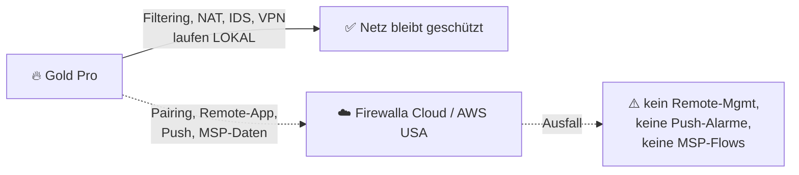

# 🔍 Grenzen & Reality Check

> Zurück zur [README](../README.md) · [🧰 Features](features.md) · [☁️ MSP](msp.md) · [💰 TCO](tco-comparison.md)

Die Gold Pro ist für ihren Preis **bemerkenswert gut**. Genau deshalb gehört hier hin, was sie **nicht** ist. Dieses Dokument ist bewusst unbequem – es soll Fehlentscheidungen verhindern, nicht Begeisterung bremsen.

| Legende | |
|---|---|
| 🟢 | Unkritisch, nur Hinweis |
| 🟡 | Funktioniert mit Einschränkungen / Prüfung nötig |
| 🔴 | Harte Grenze – wenn du das brauchst, ist Firewalla die falsche Wahl |

---

## RC-1 🟡 Geschlossenes Ökosystem

- **Fakt:** Konfiguration über **proprietäre App** (Smartphone **Pflicht**: *„A smartphone is required to use the unit“*, [Produkt-FAQ](https://firewalla.com/products/firewalla-gold-pro)) und MSP-Web. Es gibt **kein offizielles, dokumentiertes Config-Export/Import-Format** (kein `config.xml` wie bei OPNsense, kein FortiOS-CLI-Backup), das man versionieren könnte.
- **SSH:** Existiert ([Artikel](https://help.firewalla.com/hc/en-us/articles/115004397274-Does-Firewalla-have-a-SSH-)), aber Eigenanpassungen sind nicht supportet und können durch Updates verschwinden – Community-Skripte nutzen daher `post_main.d`-Hooks.
- **Roadmap:** Features kommen schnell (z. B. Suricata, AmneziaWG, MSP 2.11) – aber **nach Herstellerplan**. Wenn Firewalla eine Funktion ändert oder abkündigt (Beispiel: Simple Mode als *„Legacy feature“*), hast du keinen Fork.
- **Target Lists:** MSP-verwaltete Listen gehen bei Kündigung **verloren** ([MSP Intro](https://help.firewalla.com/hc/en-us/articles/4409866753427)).
- ✅ **Mitigation:** Regelwerk zusätzlich als **Markdown/YAML in Git** pflegen (siehe [`configs/rules/`](../configs/rules/ruleset-concept.yaml)); regelmässige App-Backups; MSP-API-Export der Regeln per Skript.

## RC-2 🟡 Cloud-Abhängigkeit (App & MSP)

- **Lokal:** Laut Firewalla arbeitet die Box bei Cloud-/Internetverlust weiter; die App kann lokal bzw. per Bluetooth zugreifen ([Artikel: Box-Zugriff ohne Internet](https://help.firewalla.com/hc/en-us/articles/360053012534-How-to-access-the-box-when-the-internet-connectivity-is-lost)).
- **App ↔ Box:** Ende-zu-Ende-verschlüsselt, Schlüssel auf Box und App ([Privacy-FAQ](https://help.firewalla.com/hc/en-us/articles/360012760073-Questions-related-to-privacy-and-data-visibility)).
- **MSP:** Daten liegen in **AWS-Containern in den USA**; *„Database storage for queries cannot be encrypted.“* Kein Self-Hosting möglich.
- **Rechtlich (FL/CH/EU):** Flows sind personenbezogene Metadaten → DSG/DSGVO-Prüfung, Drittlandtransfer, ggf. Mitarbeiterinformation. ⚠️ Keine Rechtsberatung.
- **Diag:** Firewalla benötigt bestimmte Cloud-Dienste, prüfbar über <https://diag.firewalla.com/>.
- ✅ **Mitigation:** Kritische Logs **lokal** (Node 3); MSP nur als Komfort; Notfall-Zugang via Console-Port und lokaler App dokumentieren.

## RC-3 🟡 Nur RJ45 – kein SFP+

- **Fakt:** *„No, all ports are RJ45, NBASE-T ports.“* ([Gold-Pro-FAQ](https://help.firewalla.com/hc/en-us/articles/27792411968787-Firewalla-Gold-Pro))
- **Konflikt im Cluster:** Der **Huawei S220S-24LP4JX** hat 10G nur als **2× SFP+**, die **Intel X710** auf den Nodes ebenfalls SFP+. Die RJ45-Ports des Huawei sind 1 GbE, die 2.5G-Ports sind SFP.
- **Optionen:**

| Option | Link | Risiko |
|---|---|---|
| A) **10GBASE-T-SFP+-Modul** im Huawei | 10G | ⚠️ Kompatibilität/Leistungsbudget des S220S-Ports **nicht verifiziert**; 10GBASE-T-Module werden heiss (typ. ~2–3 W ⚠️) und sind oft auf 30 m begrenzt ⚠️ |
| B) 10GBASE-T-Modul in X710 von **Node 0** (direkt) | 10G | ⚠️ X710 ist bekannt für **Modul-Whitelisting** (Intel-qualifizierte Optiken) – prüfen |
| C) Huawei-**2.5GE-SFP**-Port + 2.5GBASE-T-Modul | 2.5G | ⚠️ Modulunterstützung prüfen |
| D) Huawei-**1GbE-RJ45**-Trunk | 1G | 🟢 funktioniert sicher, reicht für viele WAN-Anschlüsse |

- **Kabel:** Firewalla empfiehlt **CAT6a** für Gold Pro ([Speedtest-Guide](https://help.firewalla.com/hc/en-us/articles/360056875493-Speed-Tests-and-Speed-Optimization-with-Firewalla)) – die Cat7-Verkabelung aus Phase 1 des Clusters ist geeignet.

## RC-4 🟡 Durchsatz mit IDS, Suricata, CAKE & PPPoE

| Bedingung | Herstellerwert | Quelle |
|---|---|---|
| Packet Processing inkl. IDS/IPS (Marketing) | **10 Gbps** | [Produktwahl-Guide](https://help.firewalla.com/hc/en-us/articles/360010465893) |
| DHCP-WAN, IDS an, QoS aus | **9.41 Gbps** | [Gold-Pro-Benchmarks](https://help.firewalla.com/hc/en-us/articles/27792411968787-Firewalla-Gold-Pro) |
| DHCP-WAN, **CAKE** | 8.75 Gbps ↓ | ebd. |
| **PPPoE**, QoS aus | 9 ↓ / 7 ↑ Gbps | ebd. |
| **PPPoE + FQ_Codel** | **3.29 ↓ / 3.48 ↑ Gbps** | ebd. |
| **PPPoE + CAKE** | **2.44 ↓ / 3.46 ↑ Gbps** | ebd. |
| **Suricata zusätzlich** | ❓ **keine Zahl veröffentlicht**; *„extremely hardware-intensive … could impact performance slightly“* | [Protect](https://help.firewalla.com/hc/en-us/articles/360049856394) |
| WireGuard | 2 Gbps | Produktseite |
| OpenVPN | 500 Mbps | Produktseite |

- **Einordnung:** Engineering-Sample, iperf3 mit 4 parallelen Streams, Laborsetup. Echte Mischlast (viele kleine Flows, DNS, kleine Pakete) liegt **typischerweise darunter** ⚠️ (allgemeine Erfahrung, kein Firewalla-Wert).
- **Inter-VLAN:** Jeder Inter-VLAN-Traffic über die Box zählt zum Durchsatz (Router-on-a-Stick über **einen** 10G-Trunk = Hin- und Rückweg teilen sich den Port). Im Cluster daher Ost-West-Traffic (50/60/80) auf **Node 0** routen, nicht über die Firewalla.
- ✅ **Mitigation:** Nach jeder Feature-Aktivierung messen (Speedtest in App + `iperf3`), Suricata nur aktivieren, wenn die Reserve es zulässt; CAKE nur bei echtem Bufferbloat.

## RC-5 🔴 Kein vollwertiges NGFW: keine TLS-Inspection

- **Fakt (Firewalla selbst):** *„Unlike some of the more powerful enterprise-grade Firewalls, Firewalla will not look at any encrypted traffic.“* ([Artikel](https://help.firewalla.com/hc/en-us/articles/360008659013))
- **Was sie sieht:** MAC, IP, Domain, **SSL-Zertifikate**, Dauer, Bytes, User-Agents, Protokoll, URL nur bei HTTP.
- **Was sie nicht sieht:** Inhalte von HTTPS, Pfade (`/something-bad.html`), Malware in verschlüsselten Downloads von unbekannten Seiten (*„Firewalla will not know. Antivirus should be able to catch that.“*).
- **Zukunftsrisiko:** **ECH** (Encrypted Client Hello) und DoH-Umgehung schwächen SNI-/DNS-basiertes Blocking weiter ⚠️ – Bypass Prevention hilft teilweise.
- **Kein:** Sandboxing, AV-Gateway, DLP, User-ID/AD-Integration, CASB.
- ✅ **Mitigation:** Endpoint-Schutz (EDR/AV) auf Clients; für Lab-Analysen eigener TLS-Proxy (z. B. mitmproxy) **nur** im isolierten LAB-VLAN 60.

## RC-6 🔴 Kein HA, kein dynamisches Routing, max. 2 WANs

- **HA:** Kein Stateful-Failover zwischen zwei Firewalla-Boxen bekannt ⚠️ (keine offizielle HA-Funktion in Produktseite/Doku gefunden). Die Box ist ein **Single Point of Failure** für den Perimeter. (Hinweis: „High Availability“ im MSP-Business-Plan betrifft **das MSP-Backend**, nicht die Box.)
- **Routing:** Statische Routen ✅, **BGP/OSPF** ❌ ⚠️ (nicht offiziell dokumentiert).
- **Multi-WAN:** *„a maximum of two WAN connections“* ([Multi-WAN-Guide](https://help.firewalla.com/hc/en-us/articles/360051575473-Firewalla-Feature-Guide-Multi-WAN)); Load Balancing L3/IP-basiert, nicht pro Applikation-SLA wie SD-WAN.
- ✅ **Mitigation:** **Cold Spare** (zweite Box im Schrank, Backup restore), dokumentierter Bypass-Plan, Node 0 als Notfall-Edge (nftables-Ruleset aus dem Companion-Repo).

## RC-7 🟡 Logging-Export: kein offizielles Syslog/NetFlow/SNMP

- **Offiziell:** MSP-**API** (Flows, Alarme), **Webhooks**, Slack, IFTTT, CSV-Export ([Integrations](https://help.firewalla.com/hc/en-us/articles/4416385766803-Integrations-for-Firewalla-MSP)). Auf eine Community-Frage nach Remote-Syslog verweist Firewalla auf die **Flow-API im MSP-Paket** ([Community-Post](https://help.firewalla.com/hc/en-us/community/posts/28656048693011-Firewalla-gold-traffic-logs-syslog-to-remote-log-server)).
- **Inoffiziell:** rsyslog-Forwarding per SSH-Skript ([Community-Gist](https://gist.github.com/mbierman/f3d184b65e0f4de6fa75a4a5d5145426)) – nicht supportet, updatefest nur via Hook.
- **Suricata-Logs der Box:** Ob/wo `eve.json` auf der Box liegt, ist **nicht dokumentiert** ⚠️.
- ✅ **Mitigation:** Node 3 betreibt **eigenes Suricata via SPAN** (unabhängig von Firewalla) + MSP-Alarm-Poller → Syslog. Siehe [`configs/integration/`](../configs/integration/node3-suricata-syslog.md).

## RC-8 🟡 Geroutete Netze hinter Node 0

- Firewalla ist **geräte-zentriert** (Device-Erkennung, DAP, Quarantäne basieren auf lokal sichtbaren Geräten/MACs). Netze **hinter** Node 0 (VLAN 50/60/80) sieht die Box nur als **IP-Adressen über den Transit-Link**.
- ⚠️ **Nicht verifiziert:** Wie gut Flows/Alarme diese Quell-IPs Geräten zuordnen; Device-Features (DAP, Quarantäne) greifen dort voraussichtlich nicht.
- **Wichtig:** Node 0 darf **nicht** NATten (sonst sieht Firewalla nur 172.16.100.2). Stattdessen statische Routen auf der Firewalla + **Source Networks** in den NAT-Einstellungen ergänzen.
- ⚠️ Port-Forwards auf Ziele **ausserhalb** der direkt angeschlossenen Netze sind nicht dokumentiert → deshalb in diesem Repo: Forward auf **Node-0-Transit-IP**, DNAT zum Honeypot erst auf Node 0.

## RC-9 🟢 Support, Garantie, Import

- **Garantie:** 1 Jahr Hersteller ([Produktseite](https://firewalla.com/products/firewalla-gold-pro)); Rückgabe 30 Tage.
- **Support:** E-Mail (`help@firewalla.com`) & Community. Ein bezahltes SLA-/Advance-Replacement-Programm ist ⚠️ nicht bekannt.
- **Hersteller-Hinweis:** *„Firewalla is not a set-and-forget security device … Some security and networking experience is required.“*
- **Import FL/CH:** Versand aus den USA; Zoll, MWST und Courier-Gebühren trägt der Käufer; US-Netzkabel im Lieferumfang (internationales Kabel separat bestellen).

## RC-10 🟢 MSP-Rollenmodell

- Nur **Owner** und **Member** (Members = fast volle Admins). Kein Read-only, keine Mandanten-Einschränkung pro Box Group ⚠️ ([MSP Intro](https://help.firewalla.com/hc/en-us/articles/4409866753427)). Audit-Activities decken **noch nicht** alle Objekttypen ab.

---

## 🧾 Fazit in einer Tabelle

| Du brauchst … | Firewalla Gold Pro? |
|---|---|
| 10G-Perimeter mit IDS/IPS, VLANs, WireGuard, ohne Abo | ✅ **Ja – sehr stark** |
| Einfache Verwaltung mehrerer Standorte für kleines Geld | ✅ Ja, mit MSP |
| Einsteigerfreundliche Visibility („wer redet mit wem“) | ✅ Ja |
| TLS-Inspection, Sandboxing, DLP, AD-User-ID | ❌ Nein → NGFW |
| HA-Cluster, BGP, > 2 WANs | ❌ Nein → OPNsense/FortiGate/UDM |
| Volle Kontrolle über IDS-Rules & Logs | 🟡 Nur zusammen mit **eigenem Suricata (Node 3)** |
| Daten ausschliesslich in EU/CH | 🟡 Box ja, **MSP nein** |
