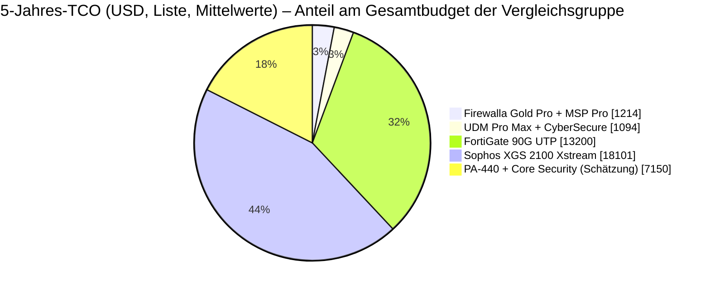
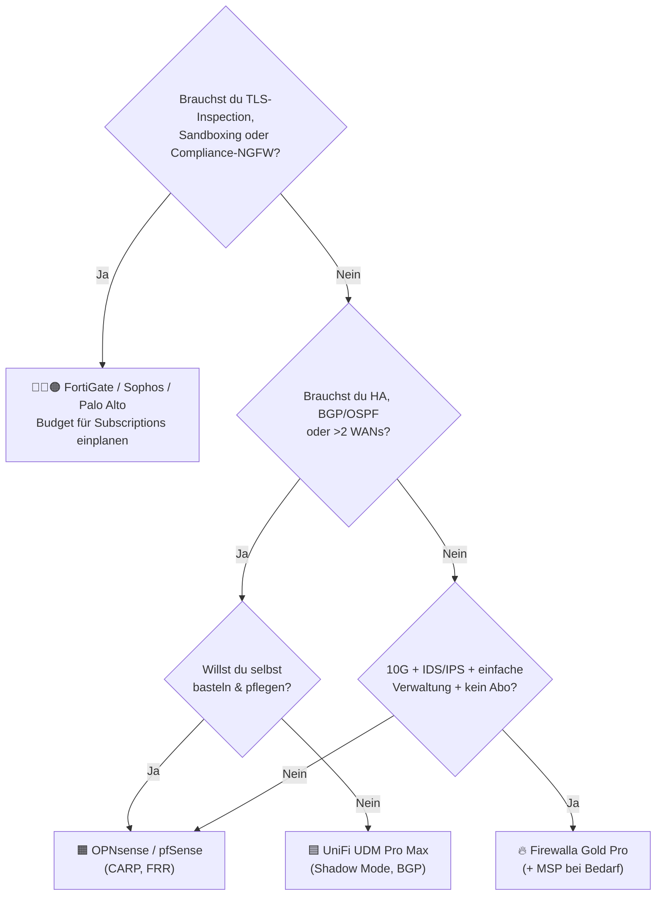

# 💰 TCO & ehrlicher Vergleich

> Zurück zur [README](../README.md) · [🧰 Features](features.md) · [☁️ MSP](msp.md) · [🔍 Reality Check](reality-check.md)

> [!IMPORTANT]
> **Spielregeln dieses Dokuments**
> 1. Alle Preise in **USD**, **ohne** MWST (FL/CH: 8.1 %), Versand, Zoll/Verzollungsgebühren, Installation.
> 2. ✅ = Hersteller-/Händler-**Listenpreis mit Link** · ⚠️ = **Schätzung/Annahme** (begründet).
> 3. Stand **13.10.2026**. Händlerpreise schwanken; Enterprise-Hersteller geben oft **erhebliche Partnerrabatte** – Listenpreise sind eine **Obergrenze**, kein Marktpreis.
> 4. Durchsatzwerte sind **Herstellerangaben unter Herstellerbedingungen**. Messmethoden unterscheiden sich (iperf3 vs. Ixia BreakingPoint, HTTP-Mix) und sind **nicht direkt vergleichbar**.

---

## 📑 Inhalt

1. [Kandidaten & Rahmen](#-1-kandidaten--rahmen)
2. [Feature-Vergleich](#-2-feature-vergleich)
3. [Leistung (Herstellerangaben)](#-3-leistung-herstellerangaben)
4. [TCO über 3 und 5 Jahre](#-4-tco-über-3-und-5-jahre)
5. [Strom](#-5-strom)
6. [Versteckte Kosten](#️-6-versteckte-kosten)
7. [Entscheidungsbaum](#-7-entscheidungsbaum)
8. [Quellen](#-quellen)

---

## 🎯 1. Kandidaten & Rahmen

**Anforderung (aus dem Companion-Cluster):** Perimeter für ein Security-Lab mit 10G-Core, IDS/IPS, VLAN-Segmentierung, Remote-VPN, 1 Standort (+ optional 1–3 weitere), 1–2 Admins.

| Kürzel | Lösung | Warum dieses Modell? |
|---|---|---|
| 🔥 **FW-GP** | Firewalla **Gold Pro** | Referenz dieses Repos |
| 🟧 **OPN/PF** | **OPNsense** oder **pfSense** auf eigener Hardware/VM | Open-Source-Klassiker |
| 🟦 **UDM** | UniFi **UDM Pro** / **UDM Pro Max** | Prosumer-Alternative mit 10G-SFP+ |
| 🔴 **FG** | FortiGate **90G** (10G-fähig) / **70G** (Einstieg) | Marktführer SMB-NGFW |
| 🔵 **SXG** | Sophos **XGS 2100** | Kleinste Rackmount-XGS mit Flexi-Port |
| 🟠 **PAN** | Palo Alto **PA-440** (Einstieg) / **PA-1410** (10G) | NGFW-Referenz |

---

## 🧩 2. Feature-Vergleich

| Feature | 🔥 Gold Pro | 🟧 OPNsense/pfSense | 🟦 UDM Pro Max | 🔴 FortiGate 90G | 🔵 Sophos XGS 2100 | 🟠 Palo Alto PA-440 |
|---|---|---|---|---|---|---|
| 10G-Ports | 2× RJ45 | je nach NIC | 2× SFP+ | 2× shared RJ45/SFP+ | ⚠️ nur via Flexi-Modul (4× SFP+) | ❌ (8× 1G) |
| IDS/IPS | ✅ Default + Suricata | ✅ Suricata (Plugin/Paket) | ✅ (Signaturen via CyberSecure erweitert) | ✅ | ✅ | ✅ |
| Eigene IDS-Rules | ❌ | ✅ voll | ⚠️ eingeschränkt | ✅ (Custom Signatures) | ⚠️ | ✅ |
| **TLS-Inspection** | ❌ | ⚠️ möglich (Proxy, aufwendig) | ❌ ⚠️ | ✅ | ✅ (TLS 1.3) | ✅ |
| L7-App-Control (Payload/Signatur) | ⚠️ Domain/SNI-basiert | ⚠️ Plugins | ✅ „Application-Aware L7“ | ✅ | ✅ | ✅ (App-ID) |
| Sandboxing | ❌ | ❌ | ❌ | ✅ (UTP) | ✅ (Zero-Day) | ✅ (WildFire) |
| WireGuard | ✅ 2 Gbps | ✅ | ✅ | ❌ ⚠️ (IPsec/ZTNA) | ❌ ⚠️ | ❌ ⚠️ |
| IPsec S2S zu Fremdgeräten | ⚠️ nur Client via MSP | ✅ | ✅ | ✅ | ✅ | ✅ |
| HA (State-Sync) | ❌ | ✅ CARP | ✅ Shadow Mode (VRRP) | ✅ A-A/A-P | ✅ | ✅ |
| BGP/OSPF | ❌ | ✅ (FRR) | ✅ | ✅ | ✅ | ✅ |
| Multi-WAN | ✅ max. 2 | ✅ beliebig | ✅ bis 8 | ✅ SD-WAN | ✅ SD-WAN | ✅ SD-WAN |
| Zentrales Mgmt | MSP (0–299 $/J.) | ⚠️ Drittlösungen / OPNcentral | UniFi Site Manager | FortiManager / FortiGate Cloud | Sophos Central (inkl.) | Panorama / SCM |
| Config-as-Code | ❌ | ✅ XML/API | ⚠️ API | ✅ API/Terraform | ✅ API | ✅ API/Terraform |
| Box-Abo nötig für Updates? | ❌ **nein** | ❌ (CE) | ❌ | ✅ FortiCare | ✅ (*„A support subscription is required to receive firmware upgrades“*) | ✅ |
| Lernkurve | 🟢 niedrig | 🔴 hoch | 🟢 niedrig | 🟡 mittel–hoch | 🟡 mittel | 🔴 hoch |

> ⚠️ Fehlende WireGuard-Unterstützung bei FortiGate/Sophos/Palo Alto: nach bestem Recherchestand nicht als natives Feature beworben – ⚠️ vor Entscheidung beim Hersteller verifizieren.

---

## 🚄 3. Leistung (Herstellerangaben)

| Gerät | Firewall | IPS | Threat Protection / „mit allem“ | VPN | Quelle |
|---|---|---|---|---|---|
| 🔥 Gold Pro | – | **10 Gbps Packet Processing inkl. IDS/IPS** (Firewalla-Methode) | Lab: 9.41 Gbps DHCP-WAN; **2.44 Gbps** PPPoE+CAKE | WG 2 Gbps · OVPN 500 Mbps | [1](https://help.firewalla.com/hc/en-us/articles/360010465893), [2](https://help.firewalla.com/hc/en-us/articles/27792411968787-Firewalla-Gold-Pro) |
| 🟦 UDM Pro Max | – | **5 Gbps** IDS/IPS | – | – | [techspecs.ui.com](https://techspecs.ui.com/unifi/cloud-gateways/udm-pro-max) |
| 🟦 UDM Pro | – | **3.5 Gbps** IDS/IPS | – | – | [store.ui.com](https://store.ui.com/us/en/products/udm-pro) |
| 🔴 FortiGate 90G | 28 Gbps | 4.5 Gbps | **2.2 Gbps** · SSL-Insp. 2.6 Gbps | IPsec 25 Gbps | [Ambio Edge / Fortinet DS](https://ambioedge.com/fortigate/90g/) |
| 🔴 FortiGate 70G | 10 Gbps | 2.5 Gbps | 1.3 Gbps | IPsec 7.1 Gbps | ebd. |
| 🔵 Sophos XGS 2100 | 30 Gbps | 6 Gbps | **1.25 Gbps** · TLS 1.1 Gbps | IPsec 17 Gbps | [EnterpriseAV / Sophos DS](https://enterpriseav.com/xgs-2100.asp) |
| 🟠 Palo Alto PA-440 | ⚠️ nicht recherchiert | ⚠️ | ⚠️ | ⚠️ | Datenblatt PAN prüfen |
| 🟧 OPNsense/pfSense | hardwareabhängig | ⚠️ Suricata stark CPU-abhängig | – | – | keine verlässliche Pauschalzahl |

> 🎓 **Warum NGFW-„Threat Protection“ so viel kleiner ist:** Fortinet/Sophos messen mit **IPS + App-Control + Malware-Scan** (Sophos: *„Firewall, IPS, Application Control, and malware prevention“*, HTTP 200 KB). Firewalla misst „Packet Processing“ mit IDS/IPS auf großen iperf3-Streams. Die Gold Pro macht **weniger Arbeit pro Paket** – deshalb ist sie schneller, nicht weil sie „besser“ ist.

---

## 🧮 4. TCO über 3 und 5 Jahre

### 4.1 Eingangswerte

| Posten | Wert | Status |
|---|---|---|
| Gold Pro Hardware | **939 $** (Aktion) – **999 $** (regulär) | ✅ [Produktseite](https://firewalla.com/products/firewalla-gold-pro) |
| MSP Professional | **49 $/Jahr** | ✅/⚠️ (Preiserhöhung 2.11, siehe [msp.md](msp.md#-2-pläne--preise)) |
| MSP Business | **299 $/Jahr** | ✅ |
| UDM Pro / Pro Max | **379 $** / **599 $** | ✅ [UDM Pro](https://store.ui.com/us/en/products/udm-pro) · [UDM Pro Max](https://store.ui.com/us/en/products/udm-pro-max) |
| UniFi CyberSecure (optional) | **99 $/Jahr** pro Site (Standard) | ⚠️ [store.ui.com/…/cybersecure](https://store.ui.com/us/en/services/cybersecure) (Preis via Suchindex/Community) |
| OPNsense Business Edition | **149 €/Jahr**; 3 Jahre **399 €** | ✅ [shop.opnsense.com](https://shop.opnsense.com/product/opnsense-business-edition/) |
| pfSense Plus + TAC Lite | **129 $/Jahr** | ✅ [shop.netgate.com](https://shop.netgate.com/products/pfsense-software-subscription-tac-lite-support) |
| Eigene x86-Hardware mit 10G-NIC | **300–800 $** | ⚠️ Schätzung (Mini-PC/1U + Intel X520/X710 gebraucht) |
| FortiGate 90G UTP-Bundle | 1 J. **5'550.40 $** · 3 J. **9'375.20 $** · 5 J. **13'200 $** | ✅ Fortinet-Liste 09/2026 via [Ambio Edge](https://ambioedge.com/fortigate/90g/) |
| FortiGate 70G UTP-Bundle | 3 J. **3'644.78 $** · 5 J. **4'840.45 $** | ✅ Liste via [Ambio Edge](https://ambioedge.com/fortigate/70g/) |
| Sophos XGS 2100 + Xstream | 1 J. **5'911.29 $** · 3 J. **12'006.23 $** · 5 J. **18'101.16 $** | ✅ Liste via [EnterpriseAV](https://enterpriseav.com/xgs-2100.asp) |
| Sophos 4× 10GE-SFP+-Flexi-Modul | **1'366.95 $** | ✅ ebd. |
| Palo Alto PA-440 Hardware | **~1'290 $** | ⚠️ Liste **2021** ([E-Rate-Katalog](https://uniti.com/wp-content/uploads/2022/08/E-Rate-Contract-PALO-ALTO-2021-Catalog.pdf)) – veraltet |
| PA-440 Core Security Bundle (ATP, Adv. URL, Adv. WildFire, DNS Sec., SD-WAN) | **~1'018–1'325 $/Jahr** | ⚠️ Händlerpreise ([Sonic Components](https://www.soniccomponents.com/product/pan-pa-440-bnd-coresec-r-palo-alto-networks/)) |
| PA-440 Support (Premium) | nicht enthalten | ⚠️ nicht recherchiert |
| PA-1410 (10G) Hardware | **~9'995 $** Liste | ⚠️ Händlerangabe ([10four](https://www.10four.org/palo-alto-networks-ngfw-pa-1410-10four-solutions/)) + Subscriptions auf Anfrage |

### 4.2 Ergebnis

| Lösung | 10G | 3 Jahre | 5 Jahre | Ø pro Jahr (5 J.) |
|---|---|---|---|---|
| 🔥 **Gold Pro, ohne MSP / MSP Lite** | ✅ | **939–999 $** | **939–999 $** | **~188–200 $** |
| 🔥 **Gold Pro + MSP Professional** | ✅ | **1'086–1'146 $** | **1'184–1'244 $** | **~237–249 $** |
| 🔥 **Gold Pro + MSP Business** | ✅ | **1'836–1'896 $** | **2'434–2'494 $** | **~487–499 $** |
| 🟦 UDM Pro (ohne / mit CyberSecure) | ✅ SFP+ | 379 $ / 676 $ | 379 $ / 874 $ | 76–175 $ |
| 🟦 UDM Pro Max (ohne / mit CyberSecure) | ✅ SFP+ | 599 $ / 896 $ | 599 $ / 1'094 $ | 120–219 $ |
| 🟧 OPNsense/pfSense CE, eigene HW | ✅ | ⚠️ 300–800 $ | ⚠️ 300–800 $ | ⚠️ 60–160 $ |
| 🟧 OPNsense BE / pfSense Plus, eigene HW | ✅ | ⚠️ ~690–1'250 $ | ⚠️ ~950–1'600 $ | ⚠️ 190–320 $ |
| 🟧 OPNsense CE als **VM auf Node 0** | ✅ (X710) | **0 $** Grenzkosten ⚠️ | **0 $** ⚠️ | 0 $ (aber Shared Fate!) |
| 🔴 FortiGate 70G UTP | ❌ | 3'645 $ | 4'840 $ | 968 $ |
| 🔴 **FortiGate 90G UTP** | ✅ | **9'375 $** | **13'200 $** | **2'640 $** |
| 🔵 **Sophos XGS 2100 Xstream** (+10G-Modul) | ⚠️ | **12'006 $** (13'373 $) | **18'101 $** (19'468 $) | **3'620–3'894 $** |
| 🟠 PA-440 + Core Security (ohne Support) | ❌ | ⚠️ ~4'350–5'270 $ | ⚠️ ~6'380–7'920 $ | ⚠️ ~1'280–1'580 $ |
| 🟠 PA-1410 + Subscriptions | ✅ | ⚠️ ≫ 10'000 $ | ⚠️ ≫ 15'000 $ | ⚠️ nicht seriös schätzbar ohne Quote |

**Rechenwege:** Gold Pro + Pro 3 J. = 939…999 + 3 × 49; 5 J. = + 5 × 49. Business analog mit 299. UDM + CyberSecure = HW + n × 99. OPNsense BE/pfSense Plus: HW 300–800 + 3 J. (387 $ bzw. 399 € ≈ ⚠️ 430 $) bzw. 5 J. (645 $ bzw. 5 × 149 € ≈ ⚠️ 800 $; Annahme 1 € ≈ 1.08 $). PA-440: 1'290 + n × (1'018…1'325).

> 🧠 **Interpretation:** Über 5 Jahre kostet die Gold Pro + MSP Professional etwa **ein Zehntel** eines FortiGate-90G-UTP-Bundles (Liste). Der Abstand schrumpft mit Partnerrabatten (oft 20–40 % ⚠️ Erfahrungswert, nicht belegt) – bleibt aber eine **Grössenordnung**. Der Preis dafür: **kein TLS-Inspection, kein HA, kein SLA-Support** (siehe [Reality Check](reality-check.md)).

---

## ⚡ 5. Strom

| Gerät | Leistung (Hersteller) | kWh/Jahr | Quelle |
|---|---|---|---|
| 🔥 Gold Pro | ~17–33 W | ~149–289 | [Produktseite](https://firewalla.com/products/firewalla-gold-pro) |
| 🔴 FortiGate 90G | Ø 19.9 W / max 20.53 W | ~174–180 | [Ambio Edge / Fortinet DS](https://ambioedge.com/fortigate/90g/) |
| 🔵 Sophos XGS 2100 | 43 W idle / 162 W max | ~377–1'419 | [EnterpriseAV / Sophos DS](https://enterpriseav.com/xgs-2100.asp) |
| 🟦 UDM Pro Max | max 60 W (inkl. NVR-HDDs) | ≤ 526 | [techspecs.ui.com](https://techspecs.ui.com/unifi/cloud-gateways/udm-pro-max) |
| 🟧 Eigene x86-Box | ⚠️ 15–60 W | ⚠️ 131–526 | Schätzung |

⚠️ **Annahme Strompreis FL/CH: 0.25–0.35 CHF/kWh** → Gold Pro ≈ **37–101 CHF/Jahr**. Im Vergleich zum Gesamt-Cluster (> 1'200 W Peak lt. Companion-Repo) vernachlässigbar.

---

## 🕳️ 6. Versteckte Kosten

| Posten | Gold Pro | NGFW (Fortinet/Sophos/PAN) | OPNsense/pfSense |
|---|---|---|---|
| 🔄 Abo läuft aus → | Box funktioniert **voll weiter** | Signaturen/Updates/oft Features **stoppen** | – |
| 🔌 Transceiver | 10GBASE-T-SFP+ am Switch ⚠️ (~40–80 $ Schätzung) | SFP+ (z. B. FortiGate SR-Optik 72 $ Liste) | je nach NIC |
| 🧑‍🏫 Know-how | gering | Zertifizierungen/Schulungen üblich | hoch, Zeit ist Geld |
| 🔁 Hardware-Ausfall | 1 J. Garantie, danach Neukauf (⚠️ kein Advance-RMA bekannt) | Advance-RMA im Support enthalten | Ersatzteile selbst |
| 📜 Logging/SIEM | MSP oder Eigenbau (Node 3) | FortiAnalyzer Cloud z. B. **819.60 $/J.** (90G, Liste) | Eigenbau |
| 🧯 HA | ❌ nicht möglich → Cold-Spare (+939 $) | 2. Gerät + 2. Bundle | 2. Box, CARP gratis |
| 💱 Import FL/CH | Versand + Zoll + 8.1 % MWST + Courier-Gebühr | meist über CH-Distributor | – |

---

## 🌳 7. Entscheidungsbaum

---

## 📖 Quellen

| Hersteller | Quelle |
|---|---|
| Firewalla | <https://firewalla.com/products/firewalla-gold-pro> · <https://help.firewalla.com/hc/en-us/articles/360010465893> · <https://help.firewalla.com/hc/en-us/articles/27792411968787-Firewalla-Gold-Pro> · <https://firewalla.net/plans> · <https://help.firewalla.com/hc/en-us/articles/25037436951699> |
| Ubiquiti | <https://store.ui.com/us/en/products/udm-pro-max> · <https://techspecs.ui.com/unifi/cloud-gateways/udm-pro-max> · <https://store.ui.com/us/en/products/udm-pro> · <https://store.ui.com/us/en/services/cybersecure> |
| Fortinet | <https://ambioedge.com/fortigate/90g/> · <https://ambioedge.com/fortigate/70g/> (Fortinet Americas 2026 MidQ3 Price List, Datasheets FG-90G-DAT-R18 / FGFWF-70G-DAT-R10) |
| Sophos | <https://enterpriseav.com/xgs-2100.asp> |
| Palo Alto | <https://www.soniccomponents.com/product/pan-pa-440-bnd-coresec-r-palo-alto-networks/> · <https://uniti.com/wp-content/uploads/2022/08/E-Rate-Contract-PALO-ALTO-2021-Catalog.pdf> · <https://www.10four.org/palo-alto-networks-ngfw-pa-1410-10four-solutions/> |
| OPNsense / pfSense | <https://shop.opnsense.com/product/opnsense-business-edition/> · <https://shop.opnsense.com/product/opnsense-business-edition-3yr/> · <https://shop.netgate.com/products/pfsense-software-subscription-tac-lite-support> |
